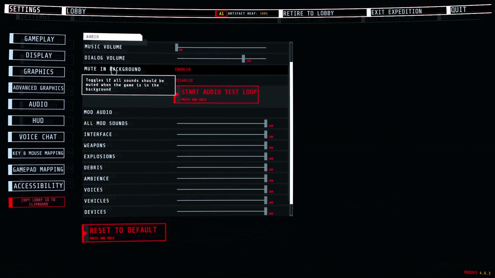

# ForgeAudio

A shared sound library for GTFO mods. Mods drop Ogg files in a folder and play them by name. ForgeAudio mixes every mod's sounds together, so they follow the game's volume sliders, share voice limits and quiet down behind walls.

ForgeAudio does nothing on its own. You normally install it because another mod needs it, such as [Forge Ordnance](https://thunderstore.io/c/gtfo/p/NAinfini/ForgeOrdnance/).

Report bugs on [GitHub](https://github.com/NAinfini/GTFO-Forge-Mods/issues), or find me on the GTFO Modding Discord as **nainfini**.

## What it does

- Plays sounds flat, at a point in the level, or following an object.
- Follows the game's sound sliders: Music for music, Dialogue for voices, SFX for everything else.
- Limits how many sounds of one kind play at once, across all mods. A stronger or nearer sound pushes out the weakest one.
- Lets a loud sound, such as an explosion, quiet debris and ambience sounds from every mod for a moment.
- Makes sounds quieter behind walls and closed doors.
- Can play one of the game's own sound events at a point for a mod, unchanged and through the game's own mix.
- Plays a mod's sound for every player at once, at the same place, without the mod writing network code.
- Varies volume and pitch from play to play and never repeats the same variant twice in a row.
- Lets a mod replace or silence one player's own footsteps, jump and landing sounds, for example while that player wears an exosuit. Every other player and every other game sound is untouched. It sends nothing over the network.

## Settings

When a mod that also uses ForgeUI is installed (Forge Ordnance and Forge Weapon Energy Lab do), the game's **Settings → Audio** page has, under the game's own sliders, a **MOD AUDIO** group: one slider for all mod sounds and one for each category (ForgeUI draws the rows; ForgeAudio keeps the values). They apply to every mod's sounds on top of the game's own sliders, take effect at once and are saved in `BepInEx/config/NAinfini.ForgeAudio.cfg` (**Volume / Master** and one entry per category, 0 to 1, default 1). The page's Reset puts them back to full.

| Category | Covers |
|---|---|
| `ui` | Menus, prompts, confirmations and warnings |
| `weapon` | Gunfire, reloads |
| `explosion` | Blasts, impacts |
| `debris` | Shrapnel, rubble |
| `ambience` | Beds, hums, loops |
| `voice` | Speech, radio |
| `vehicle` | Suits and pods: steps, servos, engines |
| `device` | Beacons, turrets, supply pods, terminals |
| `music` | Music |

Mods that use ForgeAudio have no volume settings of their own.

## Installation

Install with r2modman or the Thunderstore Mod Manager. It also installs BepInExPack_GTFO and ForgeCore. For a manual install, put the files in their own folder under `BepInEx/plugins` and install both of them too.

## For mod authors

The [developer guide](https://github.com/NAinfini/GTFO-Forge-Mods/blob/main/ForgeAudio/DEVELOPERS.md) explains how to add sounds to your mod.

## License

Code: [MIT](https://github.com/NAinfini/GTFO-Forge-Mods/blob/main/ForgeAudio/LICENSE). It includes NVorbis (MIT) to decode Ogg Vorbis; its license ships in the package.
