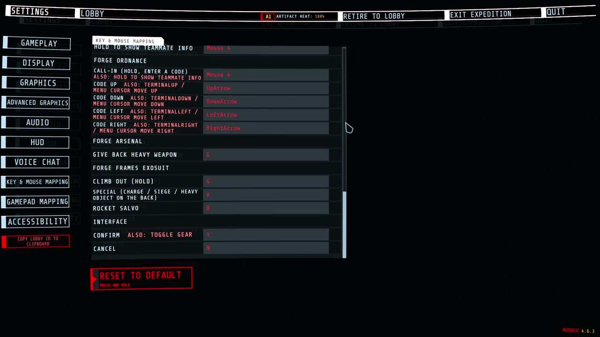
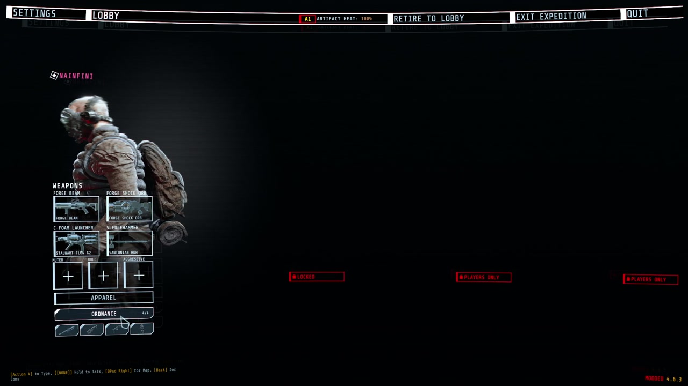
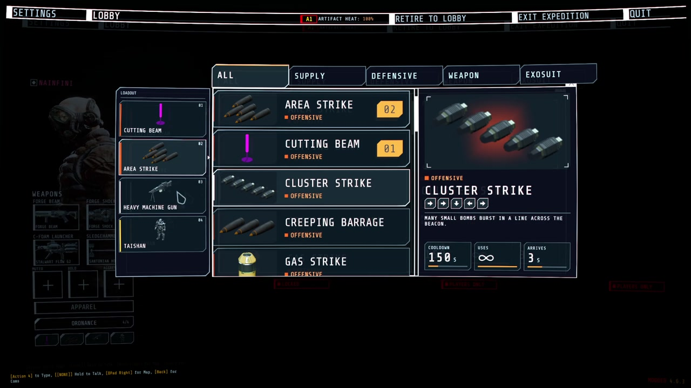
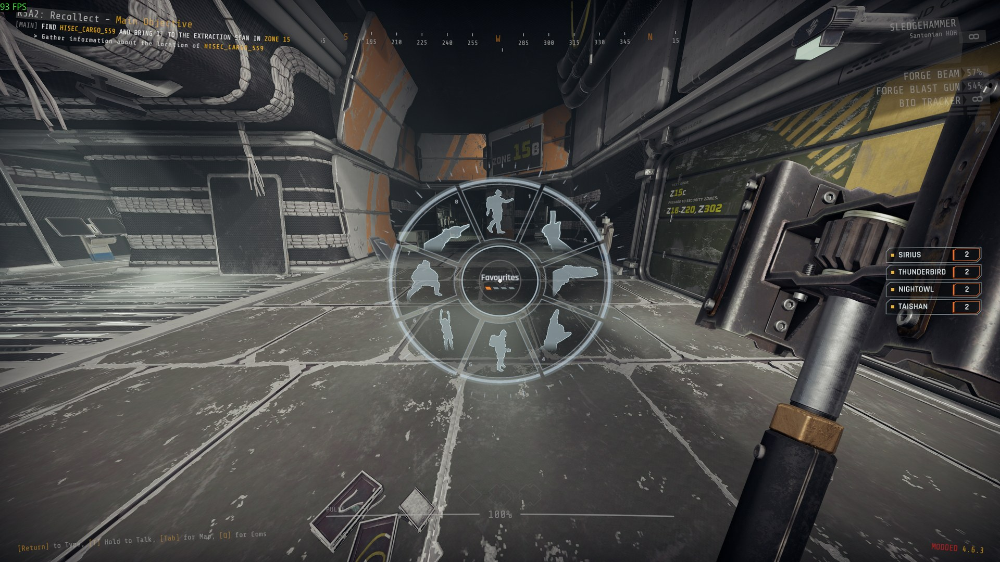
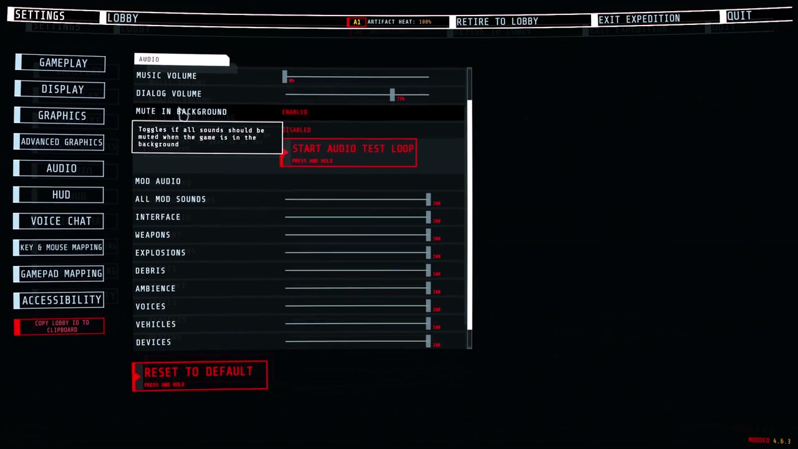
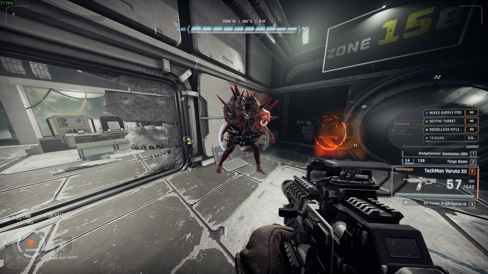
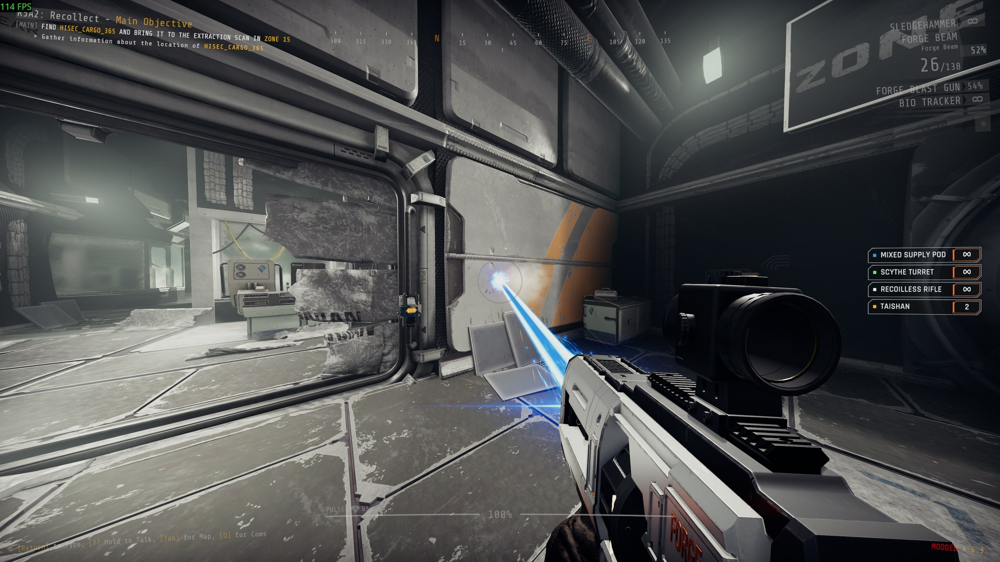
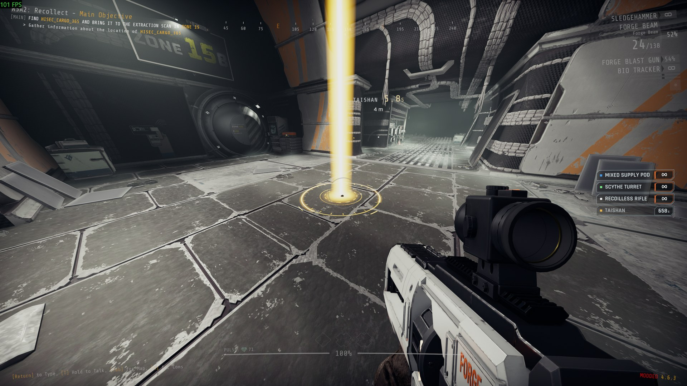
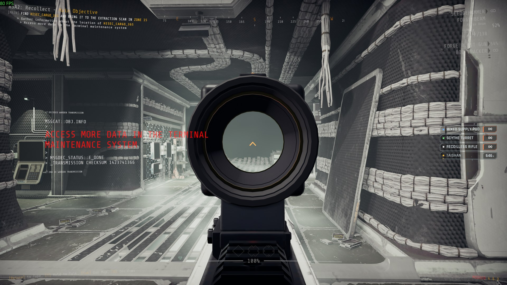

# ForgeCore

A library other GTFO mods depend on. It does nothing on its own: install it when a mod asks for it (r2modman does this for you), such as [Forge Ordnance](https://thunderstore.io/c/gtfo/p/NAinfini/ForgeOrdnance/). With no mod using it, the game looks and sounds exactly as it does without it.

It gives mods one shared base for talking over the network (a player running a different version of a mod is refused on both sides and told), taking over keys, logging, keeping settings and local progress, pooling objects, and calling the game's own damage, explosion, gear and data block systems. It also holds the shared interface, sound and visuals every Forge mod uses, so several mods never cover each other, the game's own HUD or each other's sounds.

Report bugs on [GitHub](https://github.com/NAinfini/GTFO-Forge-Mods/issues), or find me on the GTFO Modding Discord as **nainfini**.

## What mods can add: interface

- Lobby buttons under APPAREL that open loadout-style pickers.

  

- Buttons and pages on the top menu bar.
- HUD elements in named screen regions. All mods share one layout, one banner queue and one notice list.
- Ready-made HUD pieces: ability slots, key prompts, big centre text, corner notices, world markers, hit markers and damage numbers.
- A full-screen power-on layer, one at a time across all mods.
- Call-in list and inventory drawn in the same style:

  

- Cockpit pieces for vehicles and suits: hiding the game's HUD while piloting (and putting it back), moving the chat, a wide segmented armour bar, arcs beside the crosshair, a ring of contacts out of sight with a turn-around hint, ability slots, a hull damage disc, hit-direction flashes and a faint helmet visor with struts and cracks, plus the game's objectives, prompts, subtitles, inventory and teammates (with infection and ammunition) redrawn in the same style.
- Hit-direction flashes and the visor shade are merged by priority and drawn in one full-screen pass (colour flash, corner shade, low-health pulse, blur, colour split).
- Enemy health bars for the enemies you hit and can see: each hit's lost piece flashes and shrinks, a small damage number rises (a burst adds up into one), and a kill leaves a short mark and a small confirmation by the crosshair.
- A wheel in the middle of the screen: hold the mod's key, point at a slot and let go to choose it. Choices waiting for you, such as a teammate's offer, glow.

  

- A line in the player's own chat box, shown only on their machine, for notices that belong to no screen element.
- Keys you can change: every mod's keys are listed in the game's own settings (Controls), under the game's keys, one heading per mod. Click a key and press the new one; Esc cancels, Backspace or Delete unbinds, the page's reset puts them back. A key two actions or the game also use is marked.
- Texts in several languages: each mod ships one file per language, and every text switches as soon as you change the language.

## What mods can add: sound

- Sounds played flat, at a point in the level, or following an object.
- Every mod's sounds follow the game's sound sliders: Music for music, Dialogue for voices, SFX for everything else.
- A limit on how many sounds of one kind play at once, across all mods. A stronger or nearer sound pushes out the weakest one.
- A loud sound, such as an explosion, can quiet debris and ambience sounds from every mod for a moment.
- Sounds get quieter behind walls and closed doors.
- One of the game's own sound events played at a point for a mod, unchanged and through the game's own mix.
- A mod's sound played for every player at once, at the same place, without the mod writing network code.
- Volume and pitch vary from play to play, and the same variant never plays twice in a row.
- A mod can replace or silence one player's own footsteps, jump and landing sounds, for example while that player wears an exosuit. Every other player and every other game sound is untouched. It sends nothing over the network.

## What mods can add: visuals

- Outlines round enemies and objects, also through walls (above).
- Beams and trails, lit where they hit:

  

- Markers on the ground, such as where a call-in lands:

  

- New gun models on the game's guns, held by the game's own hands, with red-dot, holographic and 2x sights you aim through:

  

- Explosions and other effects with light that falls on the room, marks left on walls and floors, glow, and camera shake.

## Installation

Install with r2modman or the Thunderstore Mod Manager. It also installs BepInExPack_GTFO and GTFO_API. For a manual install, put the files in their own folder under `BepInEx/plugins` and install those two as well.

## Settings

ForgeCore is one package, but its settings stay in the files they have always had, so nothing you set is lost. They appear after the first launch.

`BepInEx/config/NAinfini.ForgeUI.cfg`, the interface. Offsets are in pixels at 1080p. Positive values move right or up.

| Setting | Default | Meaning |
|---|---|---|
| `Lobby / ButtonOffsetX`, `ButtonOffsetY` | 0 | Move every lobby button added by mods. Use it when another mod draws over them. |
| `Hud / OffsetX`, `OffsetY` | 0 | Move every HUD element added by mods. |
| `Hud / SafeMargin` | 48 | How far HUD elements keep from the screen edge. Raise it on a TV that crops the picture. |
| `Language / Language` | Auto | Language of the text in every mod that uses it. `Auto` follows the game's language; `en`, `zh` or another code forces one. A mod with no file for that language shows English. |
| `Screen / Visor` | On | Draws the helmet visor some mods show. Turn it off for a clear screen. |
| `Screen / VisorFrame` | 0.13 | Opacity of the visor's struts and corner brackets, 0 to 1. |
| `Screen / CracksMax` | 0.3 | Highest opacity of visor cracks. They never cover the middle of the screen. |
| `Screen / HitFlashPeak` | 0.35 | Peak opacity of the hit-direction flash on the screen edge. |
| `Screen / HitFlashSeconds` | 0.3 | How long a full hit flash lasts, 0.1 to 2 seconds. |
| `Screen / Glow` | 1 | Strength of the soft glow round the lit parts of HUD pieces mods draw, 0 to 2. 0 turns it off. |
| `Screen / Fringe` | On | A faint 1 px red and blue colour fringe on those pieces, like a display seen through a visor. |
| `Wheel / DeadZone` | 0.35 | How far from the centre, as a share of the wheel's radius, the pointer must move before a slot is chosen. |
| `Wheel / HoverSeconds` | 0.08 | How long the pointer rests on a slot before it lights. |
| `Wheel / TextScale` | 1 | Size of the wheel's text. |
| `Wheel / HighContrast` | Off | Solid dark slots with white text and outlines. |
| `EnemyHealthBars / Enabled` | On | Draws the enemy health bars, damage numbers and kill marks mods switch on. Off hides them in every mod. Written the first time a mod uses them. |

A value that is not a number warns once and uses 0.

Keys you changed are kept in `BepInEx/config/NAinfini.ForgeUI.keys.cfg`; a key you never changed follows the mod's default.

`BepInEx/config/NAinfini.ForgeAudio.cfg`, the sound volumes. The game's **Settings → Audio** page has, under the game's own sliders, a **MOD AUDIO** group: one slider for all mod sounds and one for each category. They apply to every mod's sounds on top of the game's own sliders, take effect at once and are saved as **Volume / Master** and one entry per category, 0 to 1, default 1. The page's Reset puts them back to full. Mods that use ForgeCore have no volume settings of their own.

| Category | Covers |
|---|---|
| `ui` | Menus, prompts, confirmations and warnings |
| `weapon` | Gunfire, reloads |
| `explosion` | Blasts, impacts |
| `debris` | Shrapnel, rubble |
| `ambience` | Beds, hums, loops |
| `voice` | Speech, radio |
| `vehicle` | Suits and pods: steps, servos, engines |
| `device` | Beacons, turrets, supply pods, terminals |
| `music` | Music |

`BepInEx/config/NAinfini.ForgeVisual.cfg`, the visuals:

- **Effects / FlashLights** (default on). Turn it off to stop blasts, hits and muzzles from flashing light on the room around them.
- **Camera / ShakeStrength** (default 1). How strongly blasts, landings and hits shake your view, from 0 (off) to 1, for every mod.
- **Outlines / Enabled** (default on). Draws the outlines mods put round enemies and objects, including any a mod shows through walls. Off hides them in every mod.
- **Culling / Enabled** (default on) and **Culling / Distance** (default 70 m). Effects farther away than the distance or outside the view pause until they are back in sight.

## Reporting a problem

Include the game build, your installed mods, a screenshot and `BepInEx/LogOutput.log`.

## For mod authors

The quick start and the list of public types are in the [developer guide](https://github.com/NAinfini/GTFO-Forge-Mods/blob/main/ForgeCore/DEVELOPERS.md).

## License

Code: [MIT](https://github.com/NAinfini/GTFO-Forge-Mods/blob/main/ForgeCore/LICENSE). It includes NVorbis (MIT) to decode Ogg Vorbis; its license ships in the package.

Fonts, under the [SIL Open Font License 1.1](https://openfontlicense.org) (full texts in `fonts/`):

- Rajdhani, © 2014 Indian Type Foundry.
- Glow Sans SC Condensed (未来荧黑), © 2021 Project Welai; the package carries its common-character subset.
