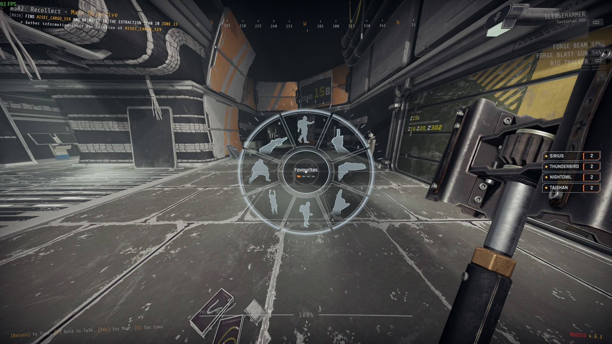

# Forge Emote

An action wheel. Hold H in a level, pick an action, and your character does it where your teammates can see it. Teammates need this mod to see your actions.

Install with r2modman or the Thunderstore Mod Manager; it also installs BepInExPack_GTFO and ForgeCore. The keys, the full list of actions and the settings are in the [developer guide](https://github.com/NAinfini/GTFO-Forge-Mods/blob/main/ForgeEmote/DEVELOPERS.md).

Report bugs on [GitHub](https://github.com/NAinfini/GTFO-Forge-Mods/issues), or find me on the GTFO Modding Discord as **nainfini**.
