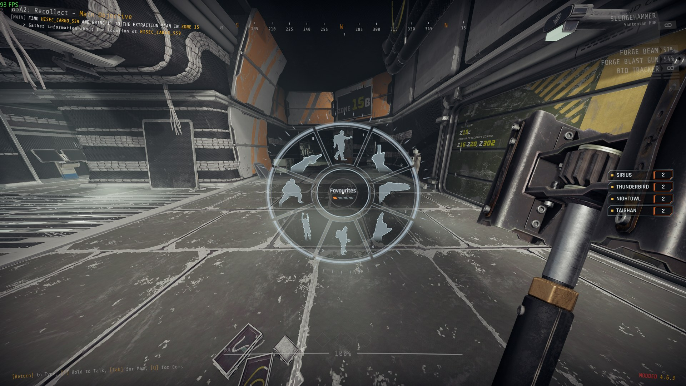
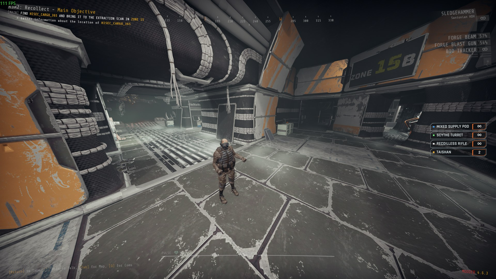
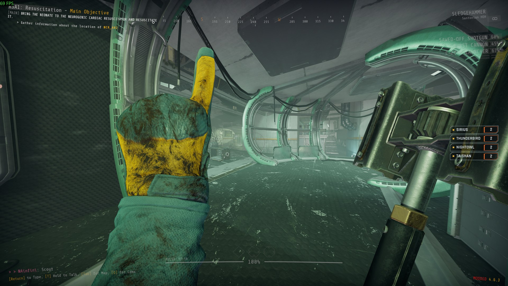

# Forge Emote

An action wheel. Hold a key, pick an action, and your character does it where your teammates can see it.

Report bugs on [GitHub](https://github.com/NAinfini/GTFO-Forge-Mods/issues), or find me on the GTFO Modding Discord as **nainfini**.

## Using it

Hold `H` in a level and the wheel opens at the centre of the screen. The key, how it fires and how long a long press lasts are under Forge mods on the game's key settings page.

- Move the pointer to an action and let go of the key, or click, to do it. Letting go with the pointer in the middle does nothing.
- The scroll wheel changes page. Keys 1 to 8 pick directly. Right click or Esc closes the wheel.
- Change the key, or make it a press instead of a hold, on the mod key page.

## The actions

| Page | Actions | What happens |
| --- | --- | --- |
| Tactical | Come here, Stop, Go there, Quiet, Wait, Follow me, Cover me, 3 2 1 | Your left arm only. You keep walking and your gun stays in your right hand. Go there also places your marker at the crosshair. 3 2 1 counts down on your fingers at the same pace on every screen. |
| Gestures | Middle finger, Wave, Cheer, Thumbs up, Pray, Backflip, Shrug on the ground, Convulse on the ground | You stand still. The first four show your hands in first person, and Cheer comes with a whistle. The last four are whole-body actions seen from behind you, like the dance; getting hit ends them. The backflip and the two on the ground change only how your body is drawn; where you stand does not change. |
| Dance | Dance, Twerk, Hip hop, Zombie stumble | Seen from behind you, and it repeats until you cancel it. Taking damage ends it. Dance, Twerk and Hip hop have music; teammates hear it from you, in time with your dance. Twerk counts as a rude gesture (see `Display.CrudeGestures`). |
| Two-player (Dance page) | Handshake, Fist bump | You hold out your hand and wait up to 15 seconds. A teammate within 1.5 m answers with the use key, or by choosing the same slot, which glows for them. You step together and play it; moving or choosing another action ends it for both. |

|  |  |
| --- | --- |
| A dance seen from behind | A gesture in first person |

Moving, firing, aiming, reloading, using something or changing weapon cancels a gesture or dance, and what you pressed still happens. Going down, being grabbed, climbing a ladder or using a terminal ends any action at once. Actions are greyed out on the wheel when you cannot do them.

Come here, Stop, Go there, Quiet ("Go quiet"), Follow me ("On me"), Cover me ("I need help"), 3 2 1 ("Three two one"), Cheer and Thumbs up also say the matching line from the game's communication menu, and every player hears it and sees its text, this mod or not.

Teammates need this mod to see your actions. Someone joining late sees the action already in progress.

## Settings

In `BepInEx/config/NAinfini.ForgeEmote.cfg`:

- `View.ThirdPerson`: on, the dance moves the view behind you; off keeps it in first person too. Tactical signals are always in first person.
- `View.ThirdPersonGestures`: off by default; on, gestures also move the view behind you.
- Middle-click a slot on the wheel to favourite it (up to 8); the first page then shows your favourites and the last ones you used. They are saved in `BepInEx/ForgeCore/Store/NAinfini.ForgeEmote.forge`.
- `View.Distance`, `View.Shoulder`, `View.Height`, `View.BlendSeconds`, `View.Orbit`: where the view stands behind you, how fast it moves, and whether the mouse turns it.
- `Display.CrudeGestures`: on by default; turn it off and other players' rude gestures play as a normal animation on your screen.
- `Debug.Readback`: on, and the log gets a line of body heights when your own action starts, ends and one second later (for reporting a body that floats). Off by default.

To reorder the wheel, write `BepInEx/config/ForgeEmote/wheel.forge`; its format is in the developer guide.

## Installation

Install with r2modman or the Thunderstore Mod Manager. It also installs BepInExPack_GTFO, ForgeCore, ForgeUI, ForgeAudio and ForgeVisual.

## For mod authors

Adding your own actions, their definitions, clips, sounds and the wheel file format is in the [developer guide](https://github.com/NAinfini/GTFO-Forge-Mods/blob/main/ForgeEmote/DEVELOPERS.md).
