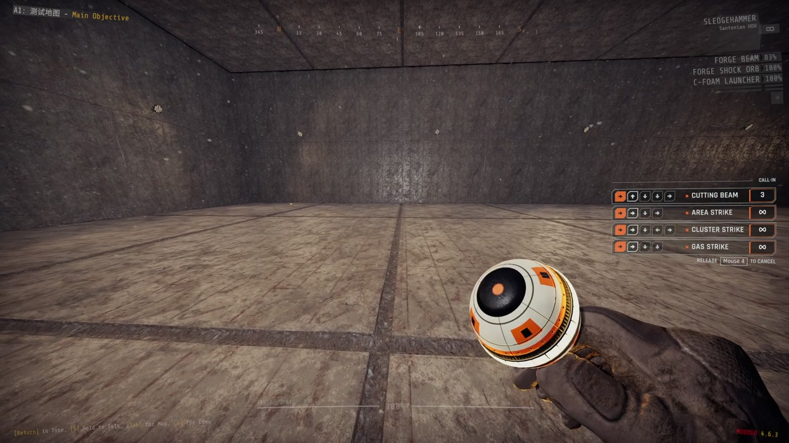

# Forge Ordnance

Call in supplies, turrets, strikes, heavy weapons and powered exosuits in GTFO. Hold a key, enter a code with the arrow keys, throw the beacon, and what you called arrives where it lands.

The mod comes with thirty call-ins and four exosuits. The former packages ForgeOrdnance_Arsenal and ForgeOrdnance_Frames are now part of Forge Ordnance and are no longer updated. Uninstall both before you install this version.

Install with r2modman or the Thunderstore Mod Manager. It also installs BepInExPack_GTFO, GTFO_API, MTFO and ForgeCore. MTFO marks the game as modded, which turns off achievements and public matchmaking. Everyone in the lobby needs the same version. How to call things in, every call-in and suit, the keys and the settings are in the [developer guide](https://github.com/NAinfini/GTFO-Forge-Mods/blob/main/ForgeOrdnance/DEVELOPERS.md).

Report bugs on [GitHub](https://github.com/NAinfini/GTFO-Forge-Mods/issues), or find me on the GTFO Modding Discord as **nainfini**.

[MIT license](https://github.com/NAinfini/GTFO-Forge-Mods/blob/main/ForgeOrdnance/LICENSE) for the code. Models, effects and sounds keep their own licences and credits, listed in the files shipped in the package; the exosuits include CC BY-NC 4.0 models, so this mod is free and non-commercial.
