# Forge Ordnance

Call in supplies, turrets, strikes, heavy weapons and powered exosuits in GTFO. Hold a key, enter a code with the arrow keys, throw the beacon, and what you called arrives where it lands.

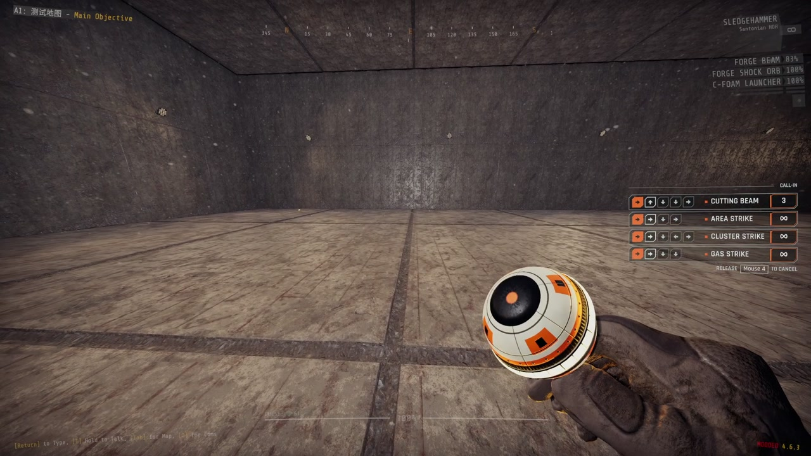

Report bugs on [GitHub](https://github.com/NAinfini/GTFO-Forge-Mods/issues), or find me on the GTFO Modding Discord as **nainfini**.

The mod comes with thirty call-ins (supply pods, turrets and standing devices, strikes, heavy weapons) and four exosuits, all listed below. Rundowns and other mods can add their own.

The former packages ForgeOrdnance_Arsenal and ForgeOrdnance_Frames are now part of Forge Ordnance and are no longer updated. Uninstall both before you install this version.

## How to call something in

1. **Pick your call-ins in the lobby.** The ORDNANCE button under APPAREL shows how many slots you have filled, for example `3/4`. Click it, click a slot, then click a call-in. EMPTY clears the slot. Two call-ins whose codes start the same way cannot be picked together. Your picks are saved on your computer. The level decides how many slots you get (4 by default) and may limit the choice.

   

   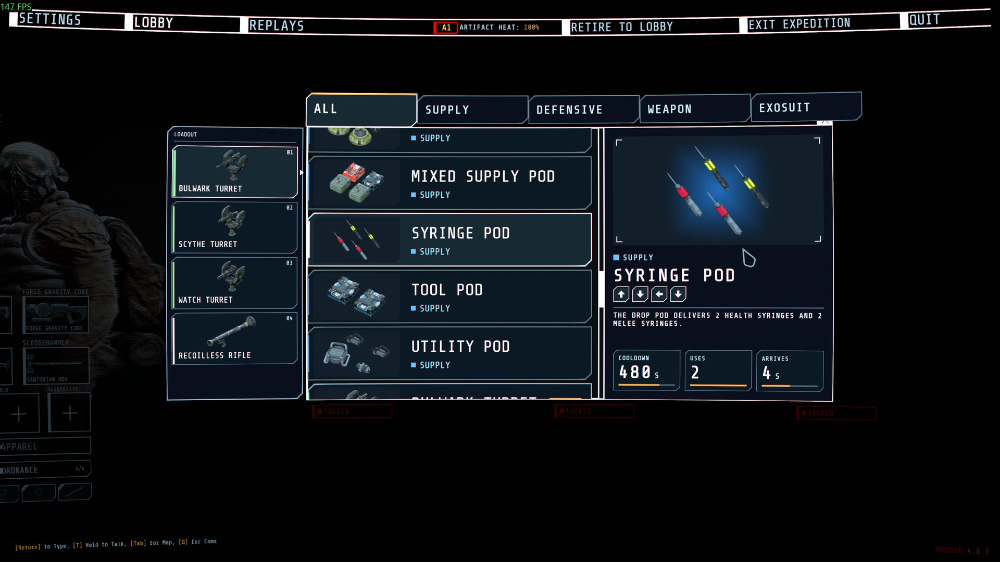

   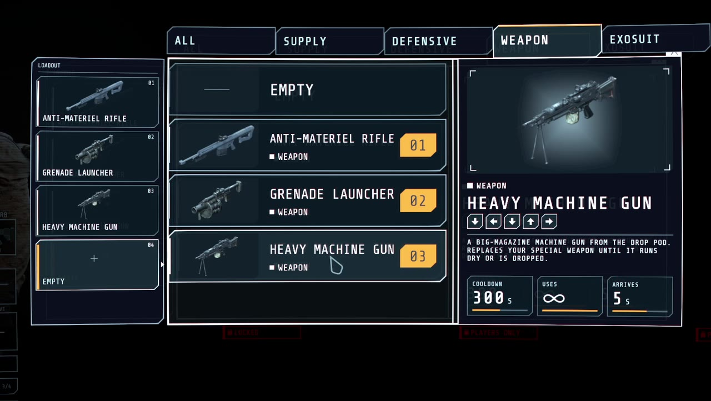

2. **Hold the call key** (rear mouse side button by default). The call-in list on the right of the screen shows every code. Your weapon is put away and the beacon appears in your hand. While you hold the key, movement, firing and weapon switching are off.
3. **Enter a code** with your movement keys or the arrow keys. Steps you have entered light up, call-ins that no longer match fade out, and call-ins on cooldown show a bar. A wrong step clears the code. Let go early and the beacon disappears.

   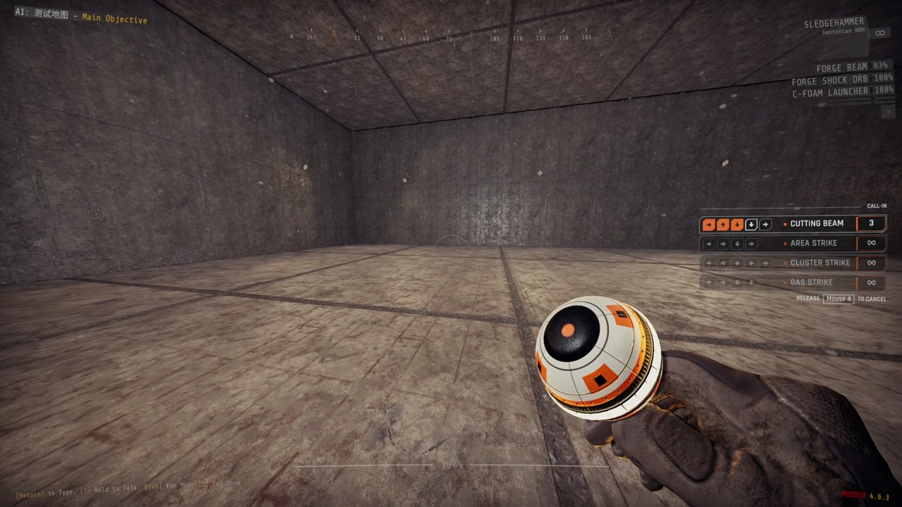

4. **Throw the beacon.** After a complete code the beacon stays in your hand when you release the call key and all keys work again. Fire charges and throws it like a glow stick. Pressing the call key again or switching weapons puts it away. Afterwards you get back the consumable and weapon you had before. You cannot start a call while carrying a cell or other heavy item.
5. **Wait for arrival.** When the beacon stops, the host checks the call: it must be in your loadout, off cooldown, have uses left, and land within range on ground a player could stand on. A refused call tells you why. An accepted call raises a glowing beam with a countdown label. When the countdown ends, the call-in arrives.

   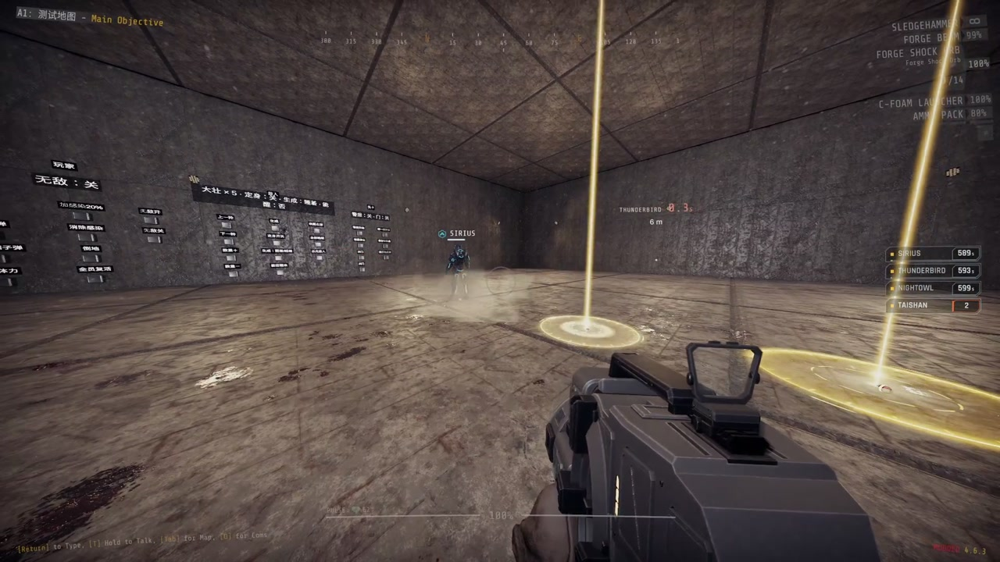

Supplies come down in a drop pod that opens its doors; take the packs from inside. Turrets arrive drill first, bore into the ground and rise up, level with the floor. The screen shakes if you are close.

## Rules

- Every player has their own cooldowns and uses.
- Cooldowns and uses return to their checkpoint values after a checkpoint reload. A call still on its way is lost.
- The level can change the number of slots, the allowed call-ins, cooldowns, uses and the maximum throw distance. It can also place call-ins itself or turn the players' call-ins off; the ORDNANCE button and the call list are then not shown.

## Supplies

Supplies arrive in a drop pod. Take the packs out of it.

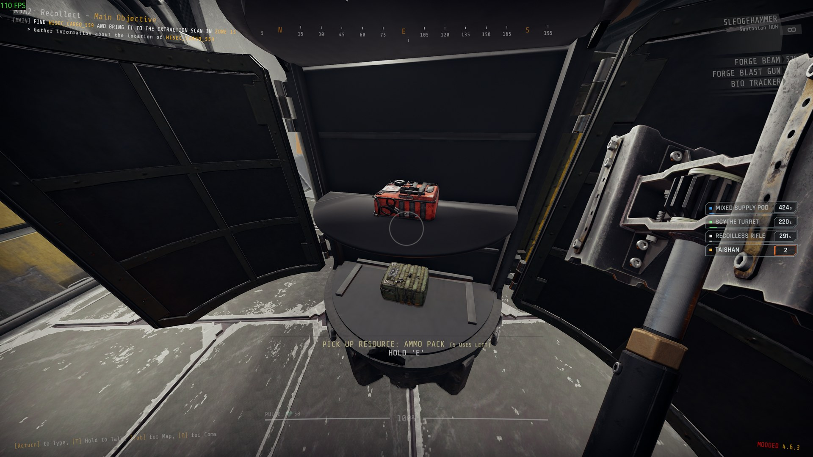

| Call-in | Code | Cooldown | Contents |
|---|---|---|---|
| Mixed Supply Pod | ↑ ↓ ↑ → | 450 s | Ammo pack x2, medipack x1, tool refill x1 |
| Ammo Pod | ↑ ↓ ↑ ← | 360 s | Ammo pack x3 |
| Medical Pod | ↑ ↓ ↓ → | 360 s | Medipack x2, disinfection pack x1 |
| Tool Pod | ↑ ↓ ↓ ← | 240 s | Tool refill x2 |
| Consumables Pod | ↑ ↓ ← ↑ | 240 s | C-foam grenade x2 |
| Syringe Pod | ↑ ↓ ← ↓ | 480 s, 2 uses | Health syringe x2, melee syringe x2 |
| Mine Pod | ↑ ↓ → ↓ | 420 s | Explosive trip mine x2, C-foam trip mine x2 |
| Utility Pod | ↑ ↓ → ↑ | 420 s | Fog repeller x1, lock melter x1, C-foam grenade x2 |

## Turrets

Each turret drills into the ground and rises up level with the floor, barrel up, then turns it level. It is stronger than the game's sentry of the same type, cannot be picked up, and sinks back underground when it runs out of ammunition or after 180 seconds. Do not plan on topping one up: an empty turret is already gone.

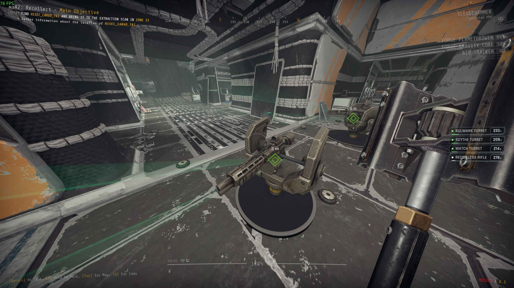 

*Turrets*

| Call-in | Code | Cooldown | Based on |
|---|---|---|---|
| Watch Turret | ← ↑ → ↓ | 240 s | Burst sentry |
| Bulwark Turret | ← ↑ → ↑ | 270 s | Sniper sentry |
| Scythe Turret | ← ↑ → ← | 240 s | Shotgun sentry |
| Foam Sprayer | ← ↓ ← ↓ | 240 s | Throws foam mines all around; they spray foam near enemies |
| Mine Layer | ← ↓ ← ↑ | 240 s | Throws mines all around; they burst near enemies |
| Scanner Tower | ← ↓ ← → | 240 s | Tags awake enemies in range for the team |
| Floodlight Tower | ← ↓ ← ← | 240 s | Lights an area and pushes the fog back |

| 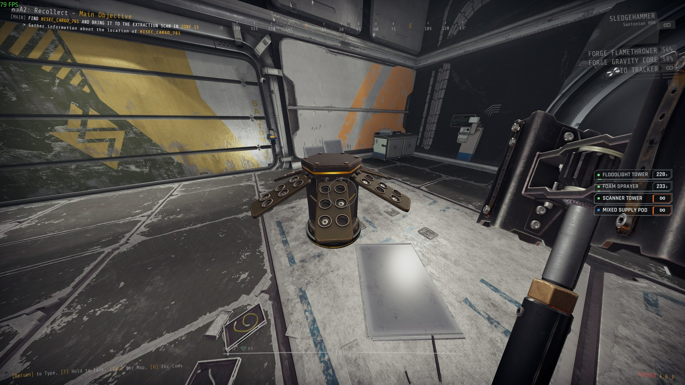 | 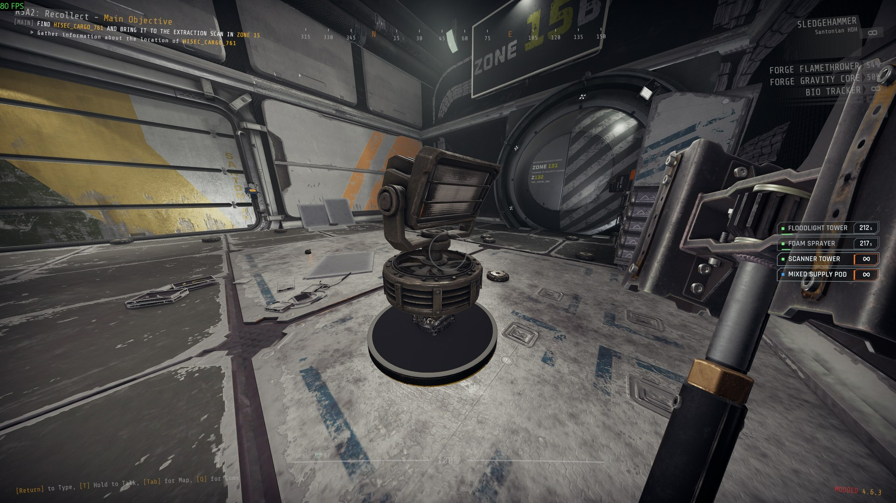 |  |
| --- | --- | --- |
| Foam Sprayer | Floodlight Tower | Scanner Tower |

## Strikes

Strikes come down through the ceiling. Gas, fire and explosions hurt your teammates.

| | | |
|:-:|:-:|:-:|
| 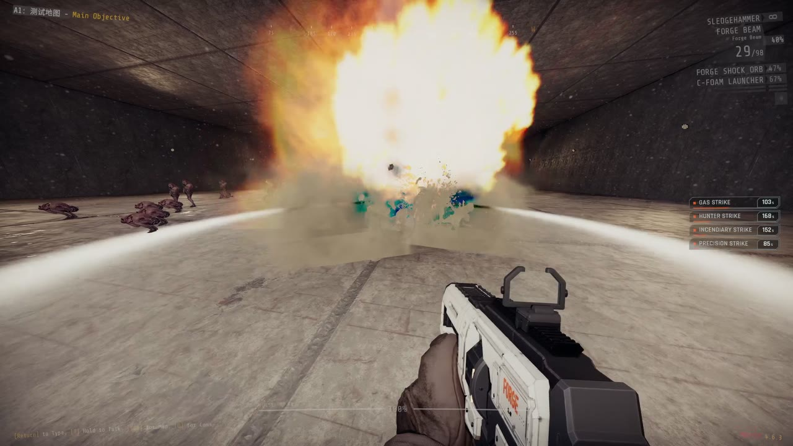 | 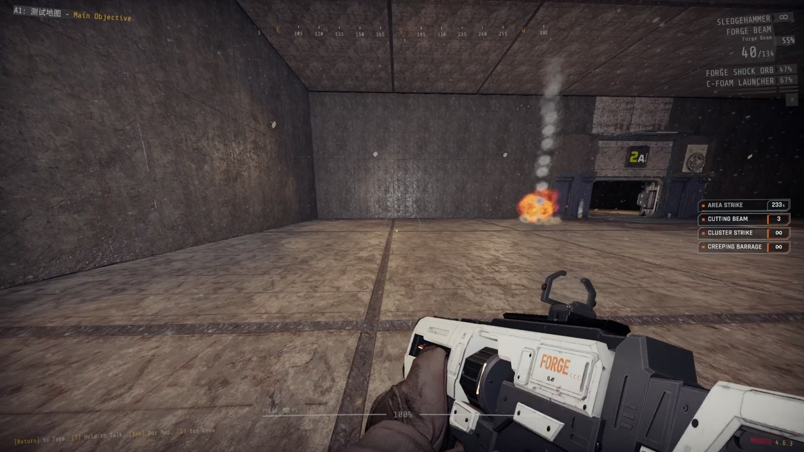 | 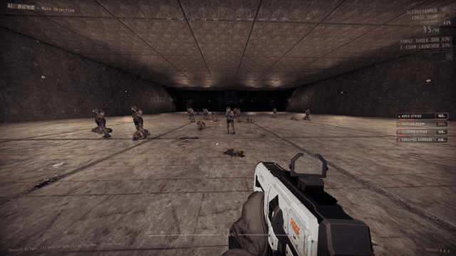 |
| Precision | Area | Creeping Barrage |
|  |  |  |
| Cluster | Incendiary | Gas |
| 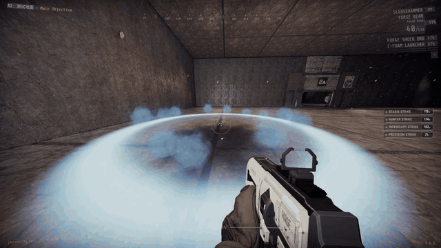 | 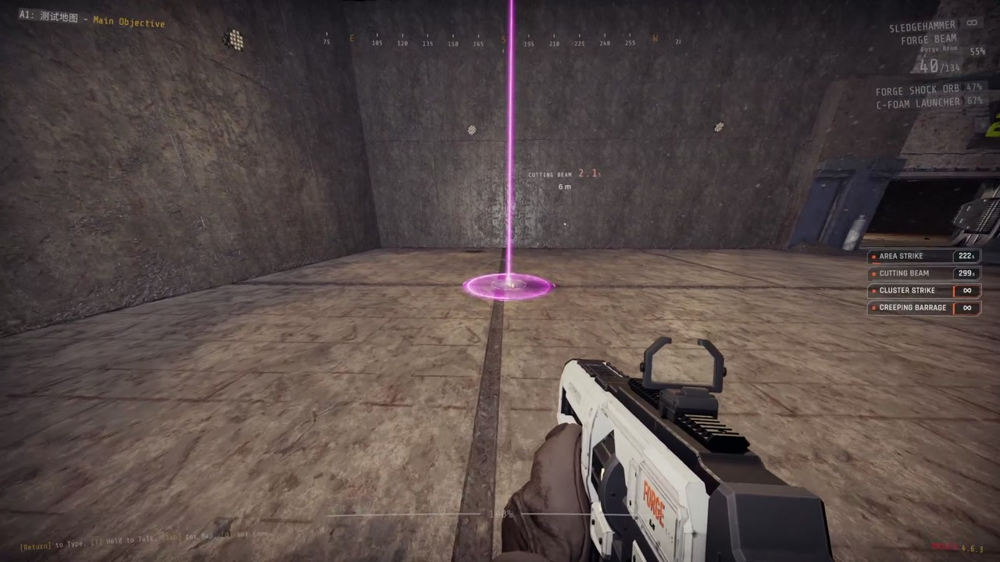 | 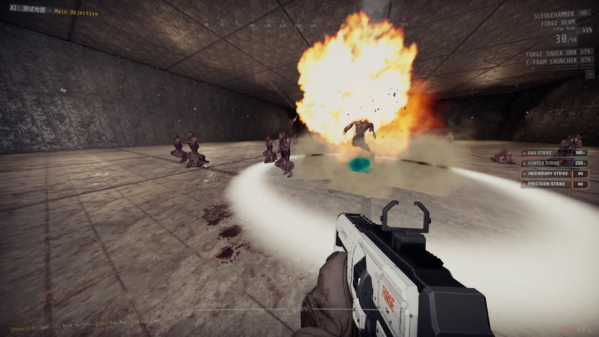 |
| Stasis | Cutting Beam | Hunter |

| Call-in | Code | Cooldown | Effect |
|---|---|---|---|
| Precision Strike | → → ↑ | 120 s | One heavy shell on the beacon |
| Area Strike | → → ↓ → | 240 s | 7 shells within about 15 m over 3.5 s |
| Creeping Barrage | → ↓ ↑ ← → | 270 s | Rows of shells walking forward along your throw |
| Cluster Strike | → → ↓ ← → | 150 s | Bomblets along a 20 m line across your throw |
| Incendiary Strike | → → ← | 180 s | A shell, then 10 s of fire around it |
| Gas Strike | → → ↓ ↓ | 150 s | A canister releasing 12 s of gas |
| Stasis Strike | → ↓ → ↑ | 120 s | Slows enemies within 8 m to a fifth of their speed for 20 s and outlines them in blue while they stay inside |
| Cutting Beam | → ↑ ↓ ↓ → | 240 s | A beam from above that cuts the nearest enemy it can walk to for 10 s |
| Strafing Run | → ↑ → ↓ | 180 s | A gun run along your throw: tracers only, no explosions, only enemies in the strip are hit |
| Hunter Strike | → ↑ ← ↑ | 210 s | A laser locks the biggest enemy in the beacon's room, then one fast shell |

## Heavy weapons

A drop pod brings a heavy weapon. Walk up to the open pod, look at the weapon and press the use key. It takes the place of your special weapon, and your own special weapon waits with its magazine and reserve.

- While a special weapon is in your hands, press the special weapon key (slot 3, as you have bound it) again to swap between your own special weapon and the heavy weapon. Both keep their magazine and reserve. It does not swap during a reload.
- When the heavy weapon runs out of ammunition it is gone, and your own special weapon comes back for good.
- Ammunition packs never refill a heavy weapon. They refill your own special weapon, even while the heavy weapon is in your hands.
- **G**, going down, or the end of the level also end the loan; you are left with your own special weapon and its ammunition. Reloading a checkpoint does the same.
- Climbing into an exosuit puts the heavy weapon away with its magazine and reserve. While you pilot, the special weapon key swaps between the suit's gun and your own special weapon, and no heavy weapon can be taken from a pod. When you climb out, by any way, the heavy weapon is back as it was: in your hands if you held it when you climbed in, otherwise still waiting. Reloading a checkpoint while piloting ends the loan as above.

| Call-in | Code | Cooldown | Weapon |
|---|---|---|---|
| Heavy Machine Gun | ↓ ← ↓ ↑ → | 300 s | Machine gun |
| Anti-Materiel Rifle | ↓ ← → ↑ ↓ | 300 s | Heavy rifle |
| Grenade Launcher | ↓ ← ↑ ← ↓ | 300 s | Grenade launcher |
| Recoilless Rifle | ↓ → ↑ ↓ | 300 s | Single-shot rocket launcher; its blast ignores armour and fades to half at the edge |
| Tracking Rifle | ↓ → ↑ ← | 300 s | Automatic rifle whose tracers bend toward enemies near your crosshair |

## Exosuits

Four powered exosuits. Call one in, it drops through the ceiling, you climb in from behind and fight in heavy armor.

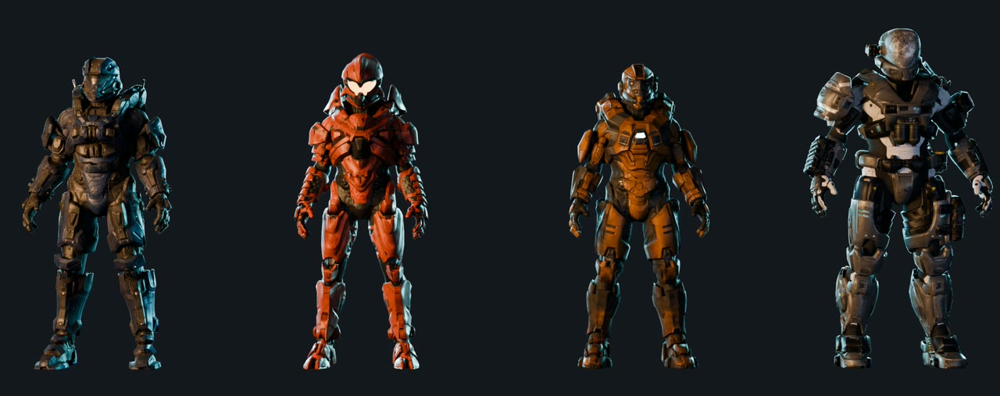

Each suit has a cooldown of 480 s (Nightowl), 540 s (Sirius) or 660 s (Thunderbird, Taishan), 2 uses per level and arrives 8 seconds after the beacon lands. All four codes start with ← ↓ → ↑ ← ↓ and end with one more arrow.

| Suit | Last arrow | Role | Special |
|---|---|---|---|
| Sirius (assault) | ↓ | Balanced, heavy machine gun | **V**: a short charge that breaks weak doors and shoves enemies aside (standing still, it charges where you look) |
| Taishan (tank) | ↑ | Heaviest armor and slowest, heavy machine gun | Energy barrier that stops enemy attacks from outside (no dome around the suit, only a short flash when it stops a hit or breaks; its bar sits on top of the armor bar). It breaks when emptied and returns after a pause. **V**: stow a heavy object on the suit's back and take it again |
| Thunderbird (firepower) | ← | Hardest-hitting heavy machine gun | **V**: plant the suit for 1.2 s with movement locked, then the suit's gun hits harder and fires faster, every gun you hold reloads faster, and you take less damage. **V** again cancels or packs up. **B**: four shoulder rockets at the point you look at, then 20 s to reload (refused when the point is close enough for the blast to reach you) |
| Nightowl (scout) | → | Light, fast, longest sprint, anti-materiel rifle | Every 5 seconds it marks every awake enemy within 30 m, like the bio tracker |

| 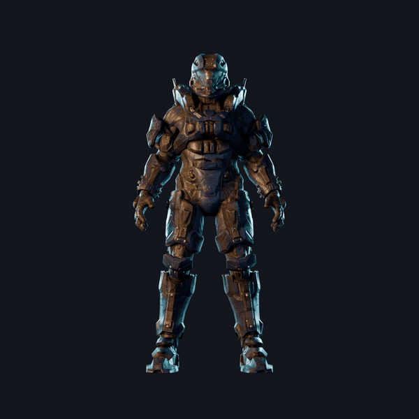 | 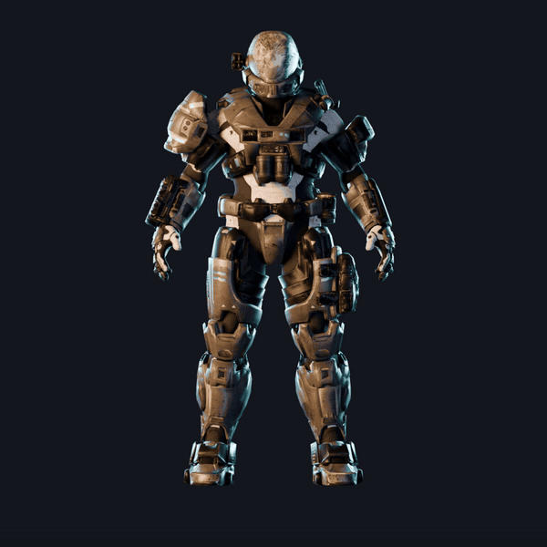 |
|---|---|
| 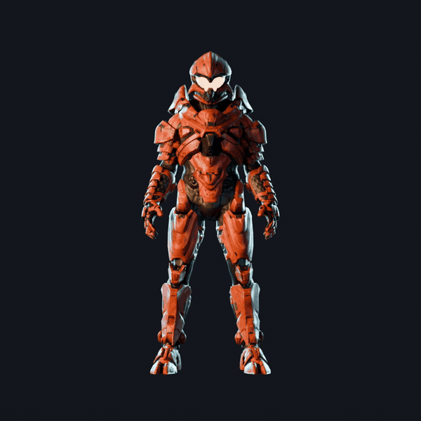 | 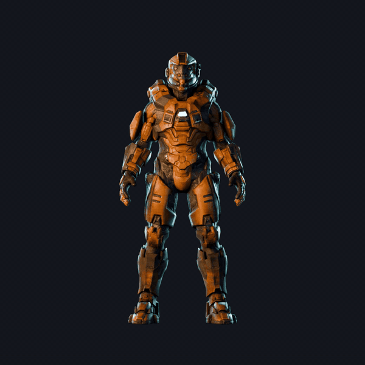 |

### Using a suit

| | |
|:-:|:-:|
|  | 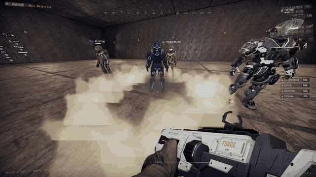 |
| Landing | Climbing in |
| 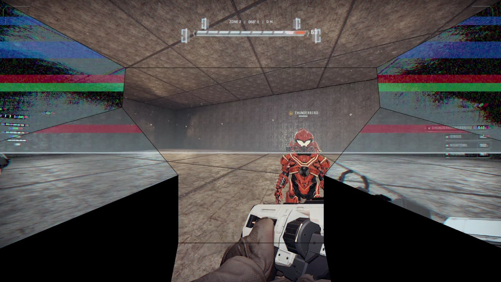 |  |
| Power-up | Cockpit |
|  |  |
| Sirius charge | Nightowl scan |
| 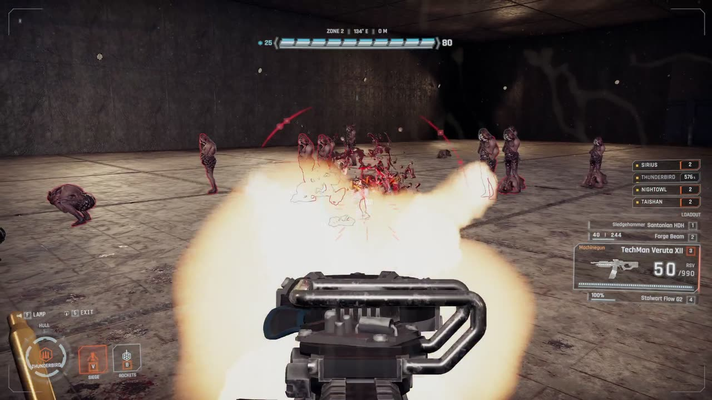 | 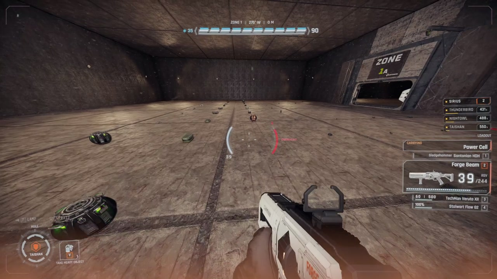 |
| Thunderbird | Taishan carrying a cell |

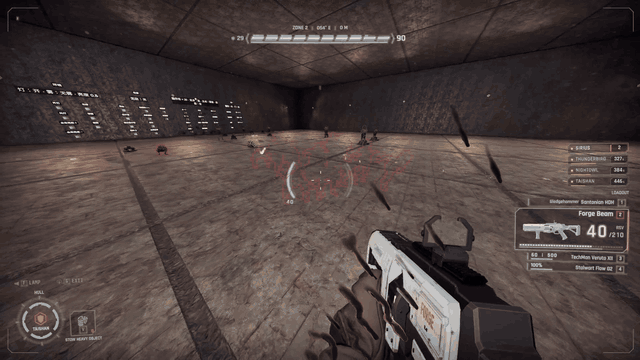

- Walk up behind an empty suit and hold the Use key to climb in. Climbing in plays a short animation, then the screen powers up. You can move once the last block of the power-up starts to come on; the rest plays on while you walk.
- Everything you normally do still works: jump, crouch, sprint, use, ping, map, chat, reload, switching weapons, tools, ladders and heavy objects.
- The suit's gun takes your special weapon slot, under the game gun's own name. It hits harder than the same gun in your hands. Press your special weapon key again while holding it to switch between the suit's gun and your own special weapon; each keeps its magazine and reserve. Its ammo is limited and nothing refills it: once it runs dry your own special weapon comes back and the suit's gun cannot be picked again. When you climb out your own special weapon comes back and the suit keeps the rounds left in its gun.
- Climbing in with a heavy weapon from a drop pod puts it away with its ammunition; the switch is always between the suit's gun and your own special weapon. While you pilot, no heavy weapon can be taken from a pod. When you climb out, the heavy weapon comes back as it was (a checkpoint reload ends the heavy weapon's loan instead).
- The suit steadies every gun you hold: less recoil and reloads in three quarters of the time. Your own guns keep their damage, fire rate and magazine.
- Ammo packs and boxes refill only your own gear: primary, tool and your own special weapon, even while the suit's gun stands in for it. A medical pack heals you as usual; it never repairs the suit.
- Every suit walks, sprints and jumps further than you do on foot. **Shift** sprints until the suit overheats and has to cool down. Nightowl is the fastest, then Sirius, Thunderbird and Taishan. Suits have no stamina.
- Every hit lands on the suit's armor, not on you, and the armor stops part of each hit. Armor never regenerates and nothing repairs it. At zero the suit is wrecked and you are thrown out. If you go down for any other reason, you are forced out.
- Your flashlight key switches on the suit's lamp, which is brighter and wider than a flashlight.
- Hold **G** to climb out. The suit stays where it stood, with its remaining armor and ammo, and anyone can climb in. The screen stays black until you have landed outside and the camera is back at your own eyes, so you never see the inside of the suit.
- Suits are loud. The landing and every step wake sleeping enemies nearby.
- You can still call things in while wearing a suit.

Inside a suit the normal HUD makes way for the suit's cockpit: armor, barrier and your health at the top with a damage silhouette, magazine and heat beside the crosshair, objectives at the top left, the interaction prompt where the game puts its own, subtitles under the crosshair, the gun at the bottom right, skills, lamp, exit and teammates at the bottom left, and chat at the bottom right. Nearby enemies show as a faint bearing ring and an outline; an enemy you hit gets a thin health bar with a small damage number, and a kill a short mark; hits glow at the screen edge they came from. Everything comes back when you climb out.

## Settings

Keys are changed in the game's settings, Controls. Your own movement keys always enter codes too.

| Key | Group in Controls | Default | Meaning |
|---|---|---|---|
| Call-in | Forge Ordnance | Rear mouse button (`Mouse3`) | Hold to enter a code. |
| Code up, down, left, right | Forge Ordnance | Arrow keys | The steps of a code. |
| Return weapon | Forge Arsenal | G | Gives up a borrowed heavy weapon at once, also while it is put away. |
| Exit frame | Forge Frames | G | Hold for 0.8 seconds to climb out of a suit. |
| Special skill | Forge Frames | V | Sirius charge, Thunderbird siege mode and Taishan heavy-object stow. The Taishan barrier and Nightowl scan are passive. |
| Rocket salvo | Forge Frames | B | Thunderbird rockets. |

| Setting | Where | Default |
|---|---|---|
| Language of every text | `NAinfini.ForgeUI.cfg`: Language `Language` (`Auto` follows the game; `en`, `zh`) | Auto |
| Move the lobby button | `NAinfini.ForgeUI.cfg`: Lobby `ButtonOffsetX` / `ButtonOffsetY` | 0 |
| Sound volume | `NAinfini.ForgeAudio.cfg` | 1 |
| Camera shake from drop pods, strikes and exosuit landings (0 off, 1 full) | `NAinfini.ForgeVisual.cfg`, section Camera: `ShakeStrength` | 1 |

Light flashes from strikes and from a destroyed suit follow ForgeVisual's `Effects / FlashLights` setting. A burning wreck's light and the planted siege lamp always stay on.

## Multiplayer

Everyone in the lobby needs the same Forge Ordnance version and the same call-in files. A player whose files differ is told in chat and cannot call anything until they match. The others are not affected. Players without the mod can play along but cannot call. The host decides every call, every hit, boarding and suit ability. Other players see the suit instead of you.

## Installation

Install with r2modman or the Thunderstore Mod Manager. It also installs BepInExPack_GTFO, GTFO_API, MTFO, ForgeCore, ForgeUI, ForgeAudio and ForgeVisual. MTFO marks the game as modded, which turns off achievements and public matchmaking.

## For rundown and mod makers

Writing your own call-ins, placing drop pods, turrets or suits from a rundown, changing the strikes or adding a suit is in the [developer guide](https://github.com/NAinfini/GTFO-Forge-Mods/blob/main/ForgeOrdnance/DEVELOPERS.md).

## License

Code: [MIT](https://github.com/NAinfini/GTFO-Forge-Mods/blob/main/ForgeOrdnance/LICENSE). Models, effects and sounds keep their own licenses and credits, listed in the `NOTICE` and `LICENSE.forge` files shipped in the package and in `fx-licences.forge` (the Asset Store packs the effect bundles are rebuilt from): effect textures are CC0 or free Unity Asset Store packs (commercial use allowed), sounds come from the author's licensed Sonniss GameAudioGDC 2026 and Boom Library collections. The four suits are adapted from fan models on Sketchfab, three of them Halo armors, each credited by author in `NOTICE`. Three of the four suit models are CC BY-NC 4.0, so this mod is free and non-commercial. Halo and its armor designs belong to Microsoft / 343 Industries; this fan mod is not affiliated with them.
