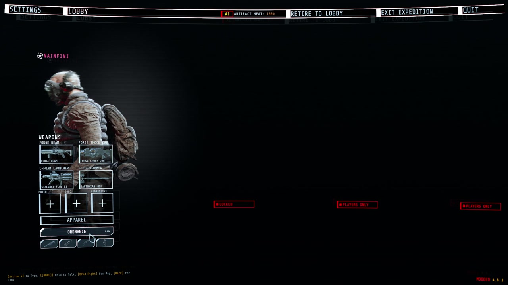
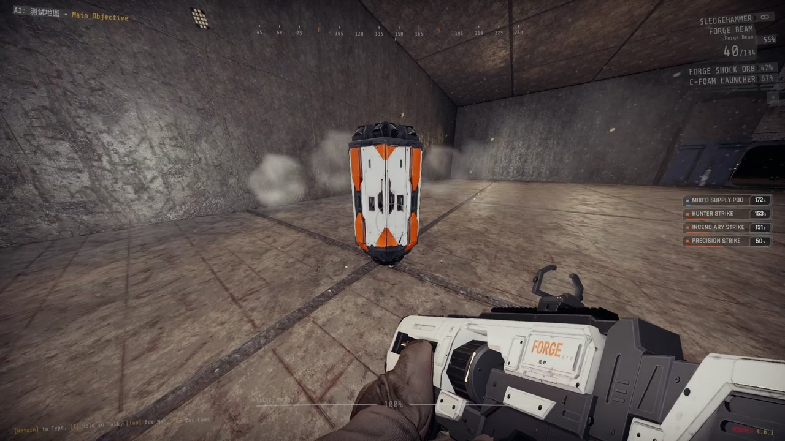

# Forge Ordnance

Call in supplies, turrets and strikes in GTFO. Hold a key, enter a code with the arrow keys, throw the beacon, and what you called arrives where it lands.

Report bugs on [GitHub](https://github.com/NAinfini/GTFO-Forge-Mods/issues), or find me on the GTFO Modding Discord as **nainfini**.

Forge Ordnance is the framework and ships no call-ins of its own. Install a content mod such as [Forge Ordnance Arsenal](https://thunderstore.io/c/gtfo/p/NAinfini/ForgeOrdnance_Arsenal/) or [Forge Ordnance Frames](https://thunderstore.io/c/gtfo/p/NAinfini/ForgeOrdnance_Frames/).

## How to call something in

1. **Pick your call-ins in the lobby.** The ORDNANCE button under APPAREL shows how many slots you have filled, for example `3/4`. Click it, click a slot, then click a call-in. EMPTY clears the slot. Two call-ins whose codes start the same way cannot be picked together. Your picks are saved on your computer. The level decides how many slots you get (4 by default) and may limit the choice.

   

   

   

2. **Hold the call key** (rear mouse side button by default). The call-in list on the right of the screen shows every code. Your weapon is put away and the beacon appears in your hand. While you hold the key, movement, firing and weapon switching are off.
3. **Enter a code** with your movement keys or the arrow keys. Steps you have entered light up, call-ins that no longer match fade out, and call-ins on cooldown show a bar. A wrong step clears the code. Let go early and the beacon disappears.

   

4. **Throw the beacon.** After a complete code the beacon stays in your hand when you release the call key and all keys work again. Fire charges and throws it like a glow stick. Pressing the call key again or switching weapons puts it away. Afterwards you get back the consumable and weapon you had before. You cannot start a call while carrying a cell or other heavy item.
5. **Wait for arrival.** When the beacon stops, the host checks the call: it must be in your loadout, off cooldown, have uses left, and land within range on ground a player could stand on. A refused call tells you why. An accepted call raises a glowing beam with a countdown label. When the countdown ends, the call-in arrives.

   

Supplies come down in a drop pod that opens its doors; take the packs from inside. Turrets arrive in a shell that falls open around them. The screen shakes if you are close.

## Rules

- Every player has their own cooldowns and uses.
- Cooldowns and uses return to their checkpoint values after a checkpoint reload. A call still on its way is lost.
- The level can change the number of slots, the allowed call-ins, cooldowns, uses and the maximum throw distance. It can also place call-ins itself or turn the players' call-ins off; the ORDNANCE button and the call list are then not shown.

## Settings

| Setting | Where | Default |
|---|---|---|
| Call key and code keys | The game's settings, Controls, under Forge Ordnance | Rear mouse button (`Mouse3`); arrow keys |
| Language of every text | `NAinfini.ForgeUI.cfg`: Language `Language` (`Auto` follows the game; `en`, `zh`) | Auto |
| Move the lobby button | `NAinfini.ForgeUI.cfg`: Lobby `ButtonOffsetX` / `ButtonOffsetY` | 0 |
| Sound volume | `NAinfini.ForgeAudio.cfg` | 1 |
| Camera shake from drop pods, strikes and exosuit landings (0 off, 1 full) | `NAinfini.ForgeVisual.cfg`, section Camera: `ShakeStrength` | 1 |

Your own movement keys always enter codes too.

## Multiplayer

Everyone in the lobby needs the same Forge Ordnance version and the same call-in files. A player whose files differ is told in chat and cannot call anything until they match. The others are not affected. Players without the mod can play along but cannot call. The host decides every call.

## Installation

Install with r2modman or the Thunderstore Mod Manager. It also installs BepInExPack_GTFO, MTFO, ForgeCore, ForgeUI, ForgeAudio and ForgeVisual. MTFO marks the game as modded, which turns off achievements and public matchmaking.

## For rundown and mod makers

Writing your own call-ins, placing drop pods or turrets from a rundown, and the extension API are in the [developer guide](https://github.com/NAinfini/GTFO-Forge-Mods/blob/main/ForgeOrdnance/DEVELOPERS.md).

## License

Code: [MIT](https://github.com/NAinfini/GTFO-Forge-Mods/blob/main/ForgeOrdnance/LICENSE). Models and sounds keep their own licenses, listed in the `License.txt` files shipped in the package: effect textures are CC0 or free Unity Asset Store packs (commercial use allowed), sounds come from the author's licensed Sonniss GDC 2026 and Boom Library collections.
