# Forge Ordnance Arsenal

Twenty call-ins for [Forge Ordnance](https://thunderstore.io/c/gtfo/p/NAinfini/ForgeOrdnance/): supply pods, sentry turrets, artillery strikes, fire, gas, stasis, a cutting beam and heavy weapons that arrive in a drop pod.

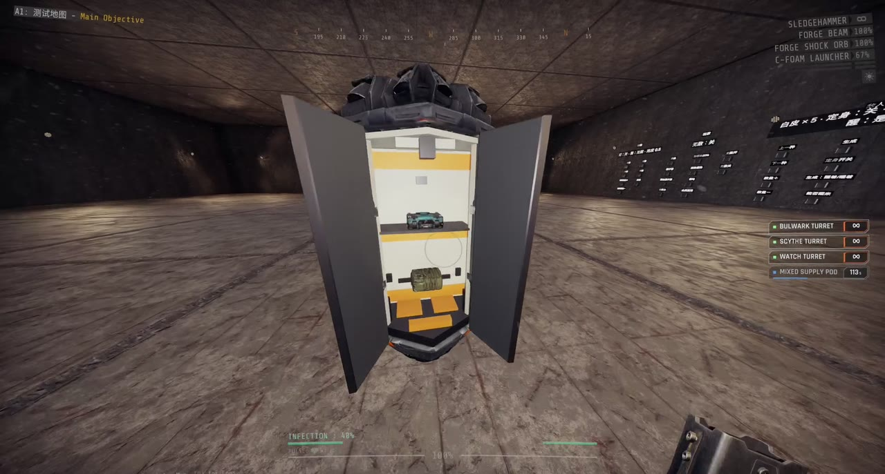

Report bugs on [GitHub](https://github.com/NAinfini/GTFO-Forge-Mods/issues), or find me on the GTFO Modding Discord as **nainfini**.

## How to use

1. Pick call-ins in the lobby with the ORDNANCE button under APPAREL.
2. In a level, hold the call key, enter the code with the arrow keys or W A S D, and throw the beacon. Forge Ordnance explains the full steps.

The in-game call-in names are Chinese.

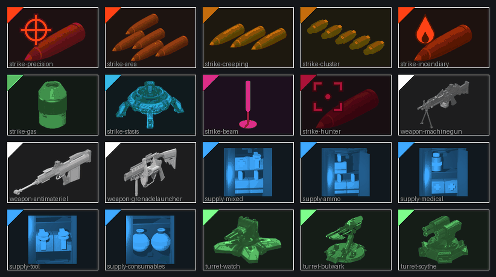

## Supplies

Supplies arrive in a drop pod. Take the packs out of it.

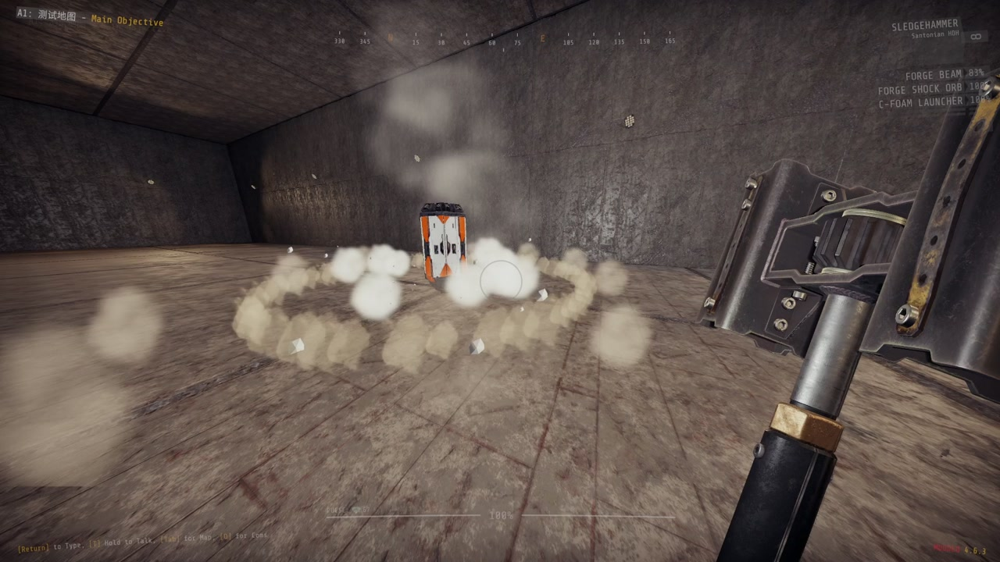

| Call-in | Code | Cooldown | Contents |
|---|---|---|---|
| Mixed Supply Pod | ↑ ↓ ↑ → | 180 s | Ammo pack x2, medipack x1, tool refill x1 |
| Ammo Pod | ↑ ↓ ↑ ← | 150 s | Ammo pack x3 |
| Medical Pod | ↑ ↓ ↓ → | 180 s | Medipack x2, disinfection pack x1 |
| Tool Pod | ↑ ↓ ↓ ← | 150 s | Tool refill x2 |
| Consumables Pod | ↑ ↓ ← ↑ | 240 s | C-foam grenade x2 |

## Turrets

Each turret crashes down in a shell that opens around it. It is stronger than the game's sentry of the same type, cannot be picked up, and leaves after 180 seconds.

| 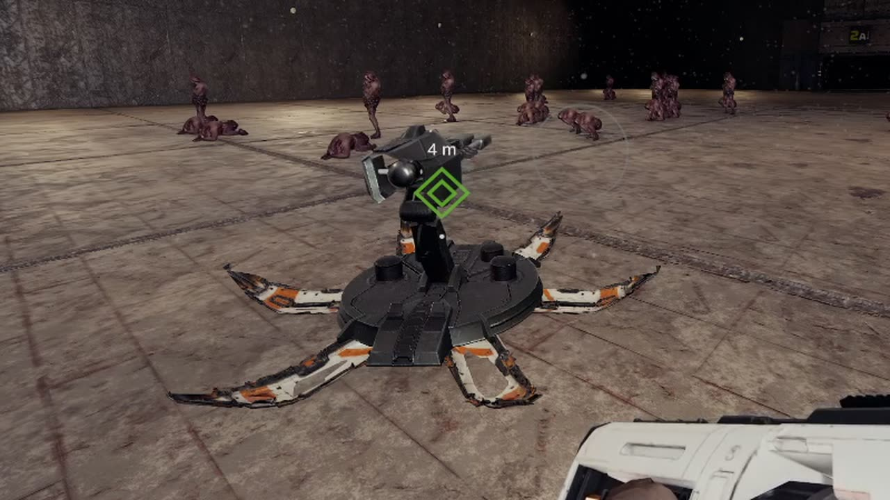 | 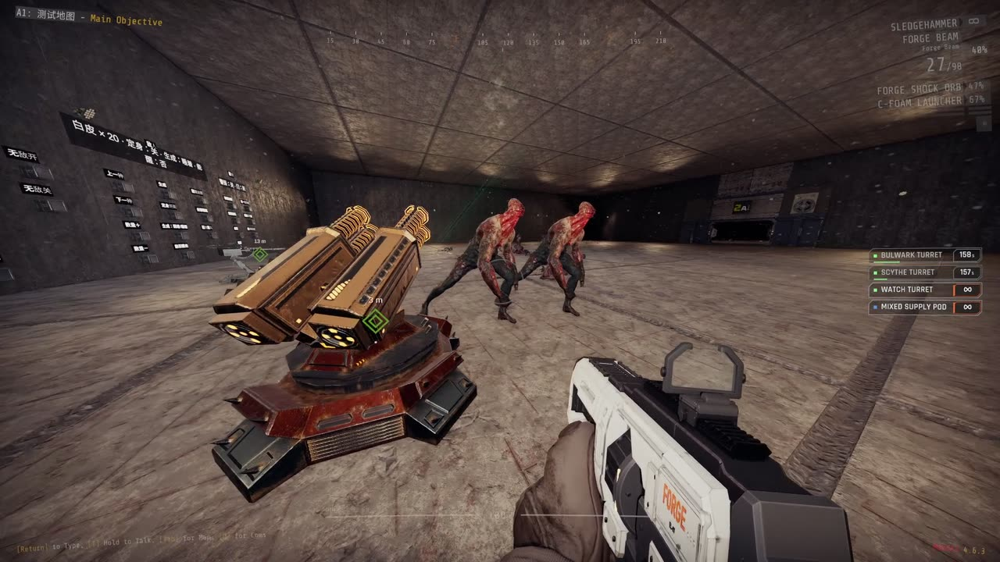 | 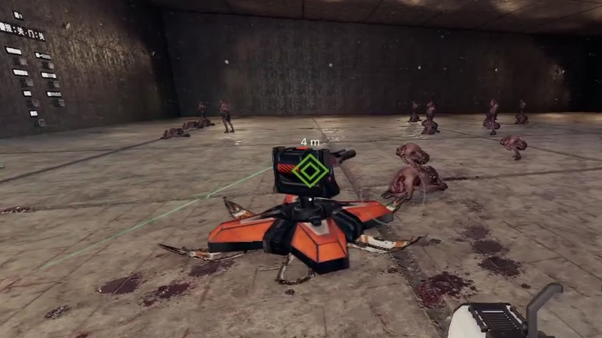 |
| --- | --- | --- |
| Bulwark | Scythe | Watch |

| Call-in | Code | Cooldown | Based on |
|---|---|---|---|
| Watch Turret | ← ↑ → ↓ | 180 s | Burst sentry |
| Bulwark Turret | ← ↑ → ↑ | 210 s | Sniper sentry |
| Scythe Turret | ← ↑ → ← | 180 s | Shotgun sentry |

## Strikes

Strikes come down through the ceiling. Gas, fire and explosions hurt your teammates.

| | | |
|:-:|:-:|:-:|
|  |  |  |
| Precision | Area | Creeping Barrage |
| 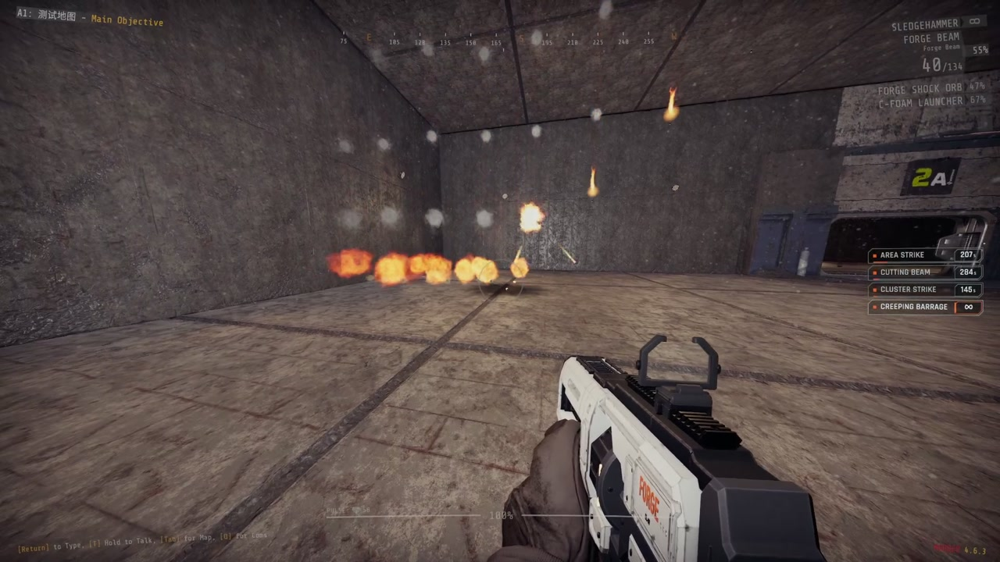 | 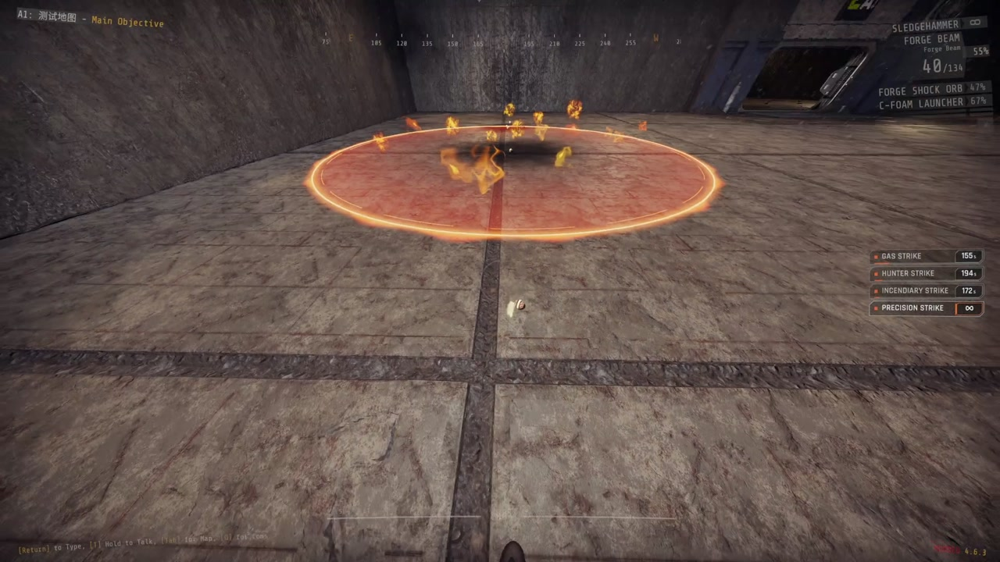 | 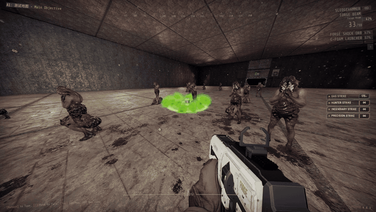 |
| Cluster | Incendiary | Gas |
|  |  |  |
| Stasis | Cutting Beam | Hunter |

| Call-in | Code | Cooldown | Effect |
|---|---|---|---|
| Precision Strike | → → ↑ | 90 s | One heavy shell on the beacon |
| Area Strike | → → ↓ → | 240 s | 7 shells within about 15 m over 5 s |
| Creeping Barrage | → ↓ ↑ ← → | 240 s | Rows of shells walking forward along your throw |
| Cluster Strike | → → ↓ ← → | 150 s | Bomblets along a 20 m line across your throw |
| Incendiary Strike | → → ← | 180 s | A shell, then 10 s of fire around it |
| Gas Strike | → → ↓ ↓ | 180 s | A canister releasing 12 s of gas |
| Stasis Strike | → ↓ → ↑ | 120 s | Slows enemies within 8 m to about a third of their speed for 20 s |
| Cutting Beam | → ↑ ↓ ↓ → | 300 s, 3 uses | A beam from above that cuts the nearest enemy it can walk to for 10 s |
| Hunter Strike | → ↑ ← ↑ | 210 s | One shell on the biggest enemy near the beacon |

## Heavy weapons

A drop pod brings a heavy weapon. Walk up to the open pod, look at the weapon and press the use key. It takes the place of your special weapon, and your own special weapon waits with its magazine and reserve.

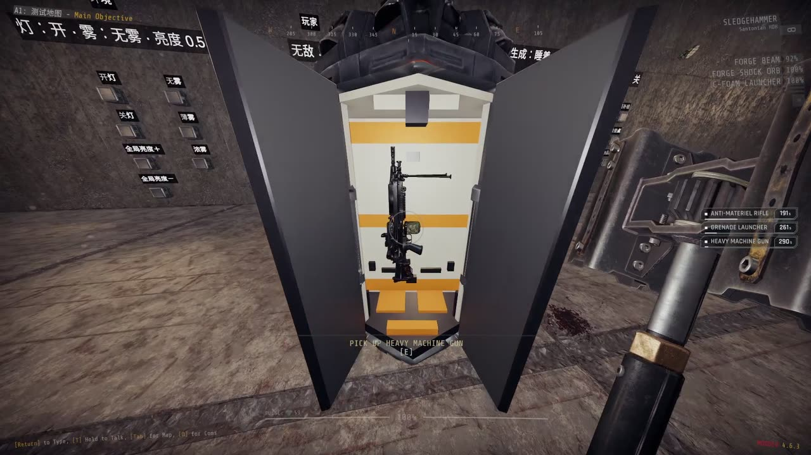

| 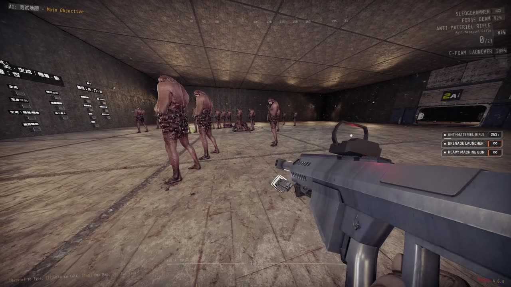 | 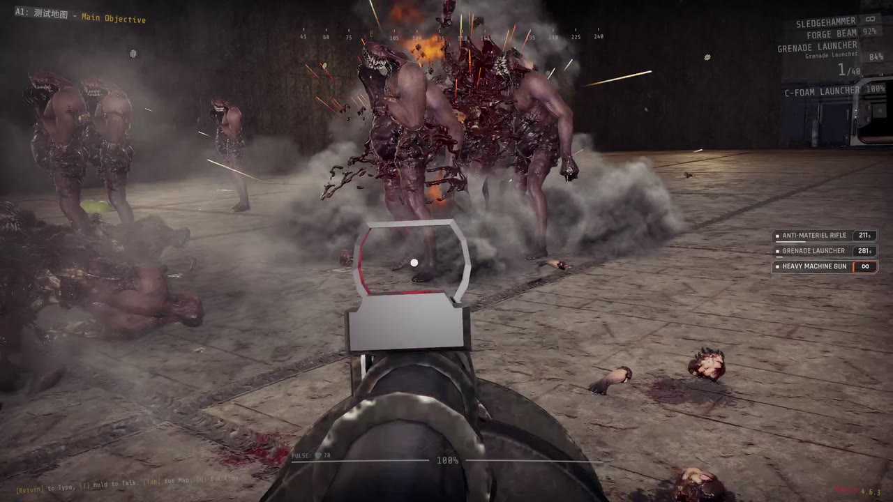 | 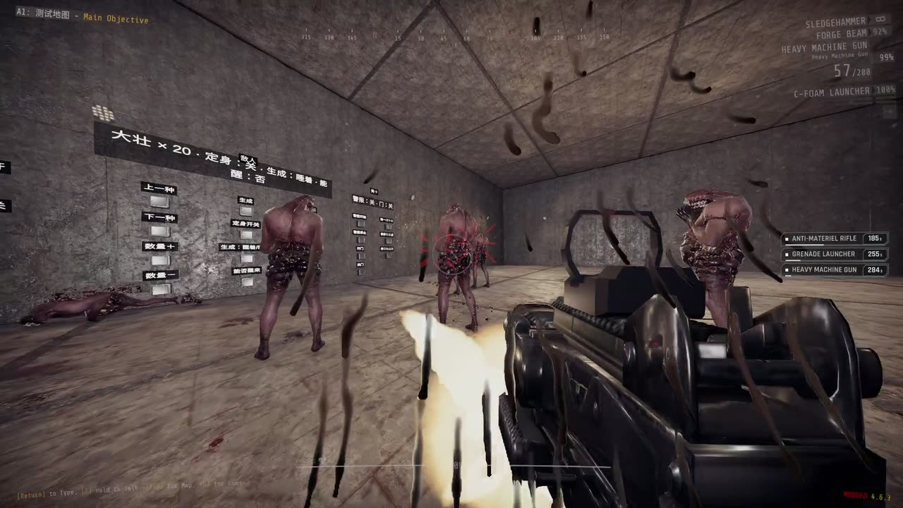 |
| --- | --- | --- |
| Anti-Materiel Rifle | Grenade Launcher | Heavy Machine Gun |

- While a special weapon is in your hands, press the special weapon key (slot 3, as you have bound it) again to swap between your own special weapon and the heavy weapon. Both keep their magazine and reserve. It does not swap during a reload.
- When the heavy weapon runs out of ammunition it is gone, and your own special weapon comes back for good.
- Ammunition packs never refill a heavy weapon. They refill your own special weapon, even while the heavy weapon is in your hands.
- **G**, going down, or the end of the level also end the loan; you are left with your own special weapon and its ammunition. Reloading a checkpoint does the same.
- Climbing into a [Forge Ordnance Frames](https://thunderstore.io/c/gtfo/p/NAinfini/ForgeOrdnance_Frames/) exosuit puts the heavy weapon away with its magazine and reserve. While you pilot, the special weapon key swaps between the suit's gun and your own special weapon, and no heavy weapon can be taken from a pod. When you climb out, by any way, the heavy weapon is back as it was: in your hands if you held it when you climbed in, otherwise still waiting. Reloading a checkpoint while piloting ends the loan as above.

| Call-in | Code | Cooldown | Weapon |
|---|---|---|---|
| Heavy Machine Gun | ↓ ← ↓ ↑ → | 300 s | Machine gun |
| Anti-Materiel Rifle | ↓ ← → ↑ ↓ | 300 s | Heavy rifle |
| Grenade Launcher | ↓ ← ↑ ← ↓ | 300 s | Grenade launcher |

## Settings

Give back heavy weapon (G by default) gives up a borrowed heavy weapon at once, also while it is stashed; change it in the game's settings, Controls, under Forge Arsenal.

`BepInEx/config/NAinfini.ForgeOrdnanceArsenal.cfg`:

| Setting | Default | Meaning |
|---|---|---|
| `Extra lights` | On | Extra lights and flashes on strikes and beams. Turn it off for a lighter picture. |

None of these change damage or timing.

## Multiplayer

The host decides everything. Every player needs the same version of Arsenal and Forge Ordnance.

## Installation

Install with r2modman or the Thunderstore Mod Manager. It also installs Forge Ordnance, MTFO, ForgeCore, ForgeUI, ForgeAudio and ForgeVisual. MTFO marks the game as modded, which turns off achievements and public matchmaking.

## License

Code: [MIT](https://github.com/NAinfini/GTFO-Forge-Mods/blob/main/ForgeOrdnance_Arsenal/LICENSE). Models and sounds keep their own licenses, listed in the `License.txt` files shipped in the package.

Modding the strikes or adding call-ins: see the [developer guide](https://github.com/NAinfini/GTFO-Forge-Mods/blob/main/ForgeOrdnance_Arsenal/DEVELOPERS.md).
