# Forge Ordnance Frames

Four powered exosuits for [Forge Ordnance](https://thunderstore.io/c/gtfo/p/NAinfini/ForgeOrdnance/). Call one in, it drops through the ceiling, you climb in from behind and fight in heavy armor.

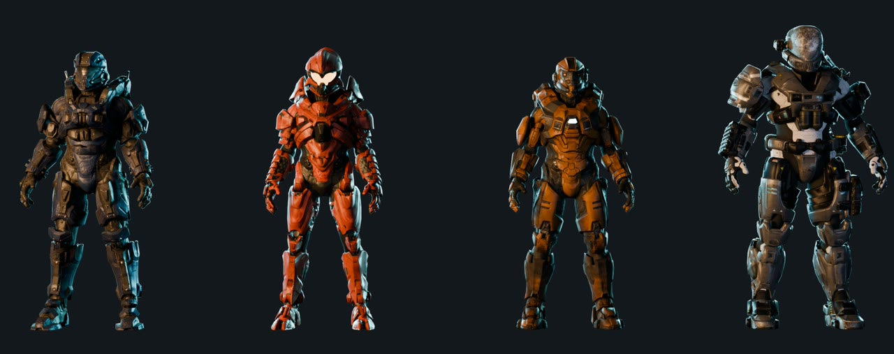

Report bugs on [GitHub](https://github.com/NAinfini/GTFO-Forge-Mods/issues), or find me on the GTFO Modding Discord as **nainfini**.

## Call-ins

Pick a suit in the lobby with the ORDNANCE button under APPAREL. Each suit has a 600 second cooldown, 2 uses per level and arrives 8 seconds after the beacon lands. All four codes start with ← ↓ → ↑ ← ↓ and end with one more arrow.

| Suit | Last arrow | Role | Special |
|---|---|---|---|
| Sirius (assault) | ↓ | Balanced, heavy machine gun | **V**: a short charge that breaks weak doors and shoves enemies aside |
| Taishan (tank) | ↑ | Heaviest armor and slowest, heavy machine gun | Energy barrier around the suit that stops enemy attacks from outside. It breaks when emptied and returns after a pause. Carries heavy objects without slowing down |
| Thunderbird (firepower) | ← | Hardest-hitting heavy machine gun | **V**: plant the suit for 1.2 s with movement locked, then the suit's gun hits harder and fires faster, every gun you hold reloads faster, and you take less damage. **V** again cancels or packs up. **B**: four shoulder rockets at the point you look at, then 15 s to reload |
| Nightowl (scout) | → | Light, fast, longest sprint, anti-materiel rifle | Every 5 seconds it marks every enemy within 30 m, like the bio tracker |

| 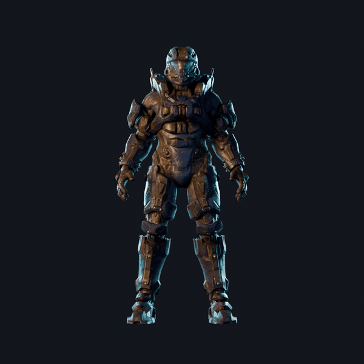 | 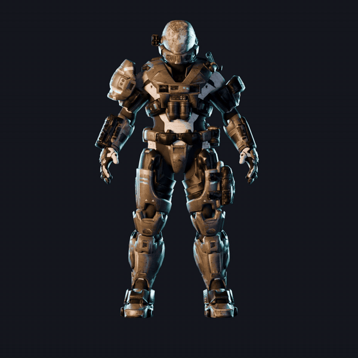 |
|---|---|
| 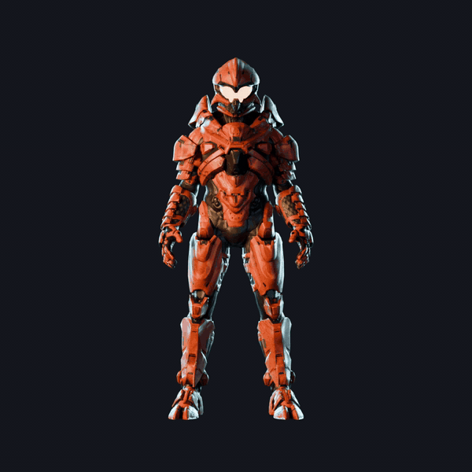 | 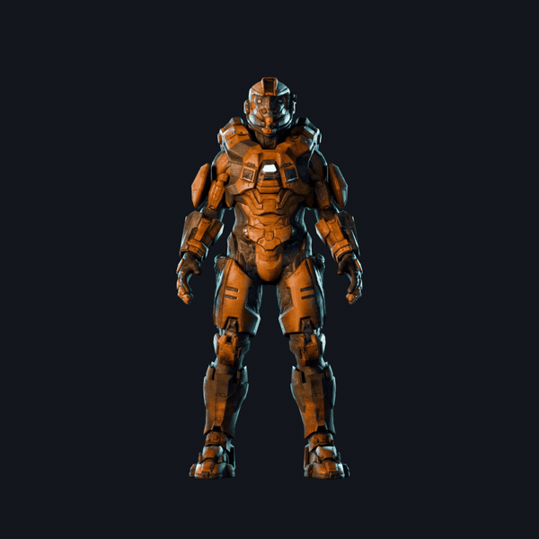 |

## Using a suit

| | |
|:-:|:-:|
| 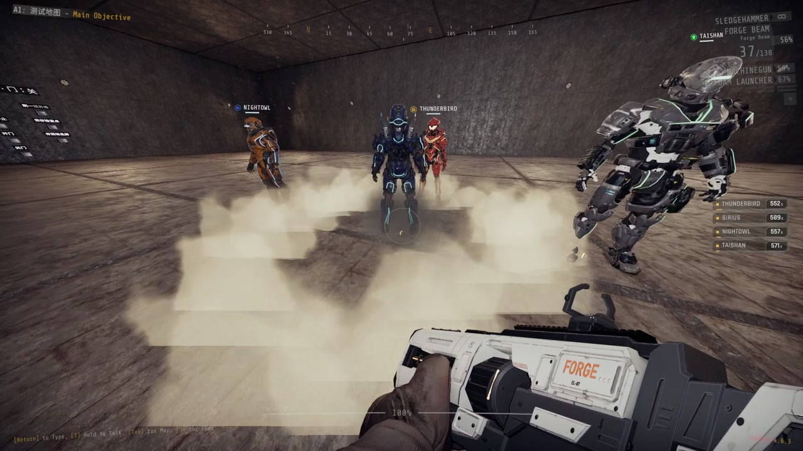 | 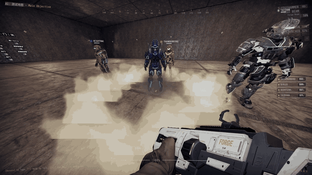 |
| Landing | Climbing in |
| 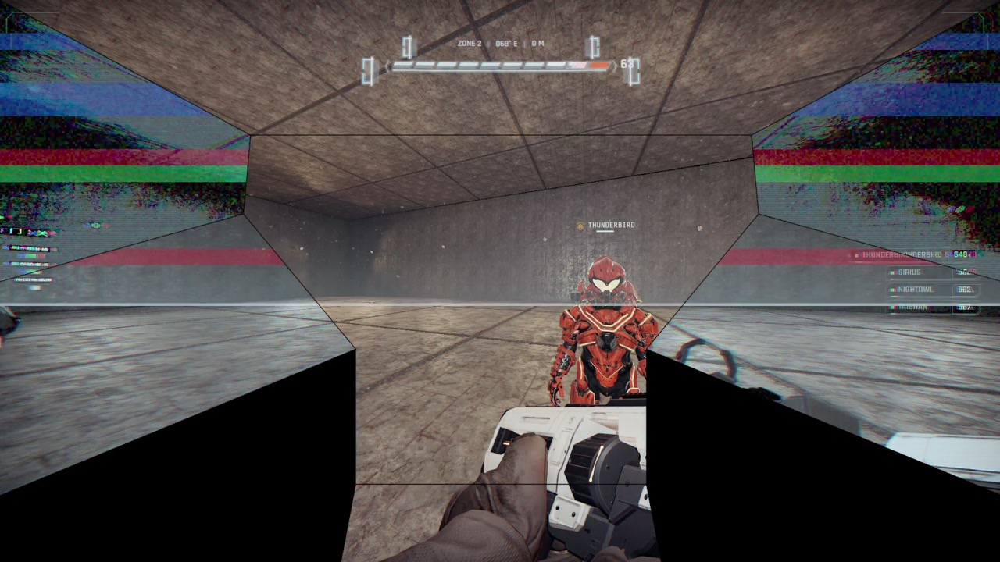 | 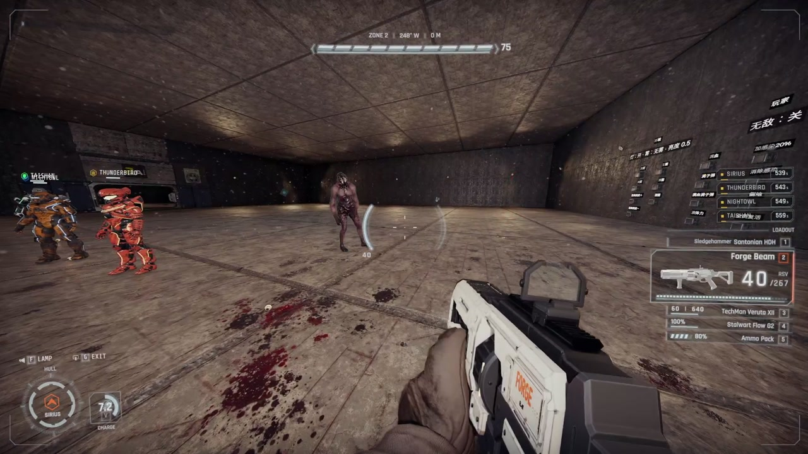 |
| Power-up | Cockpit |
| 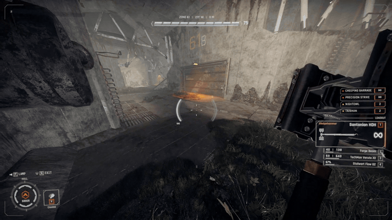 | 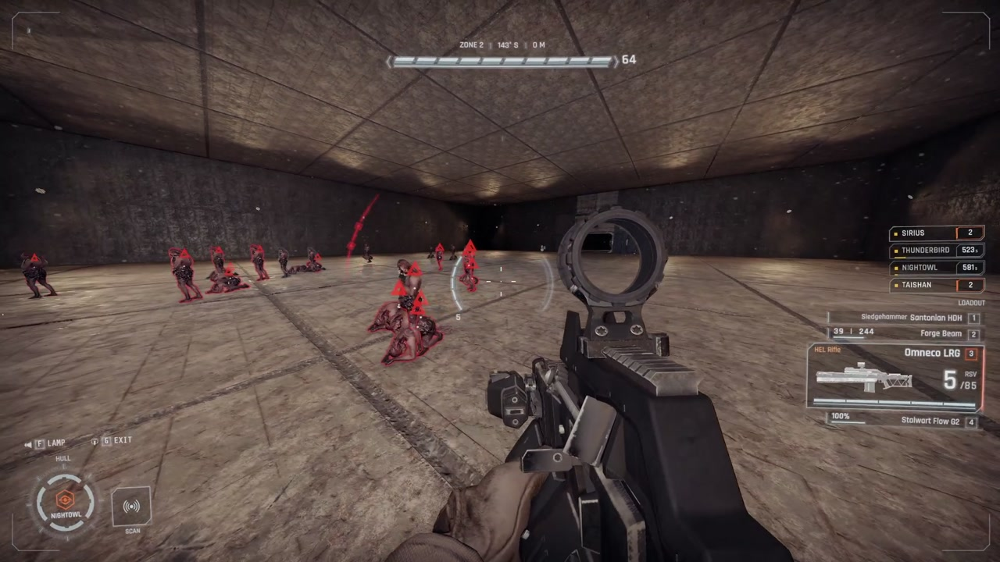 |
| Sirius charge | Nightowl scan |
| 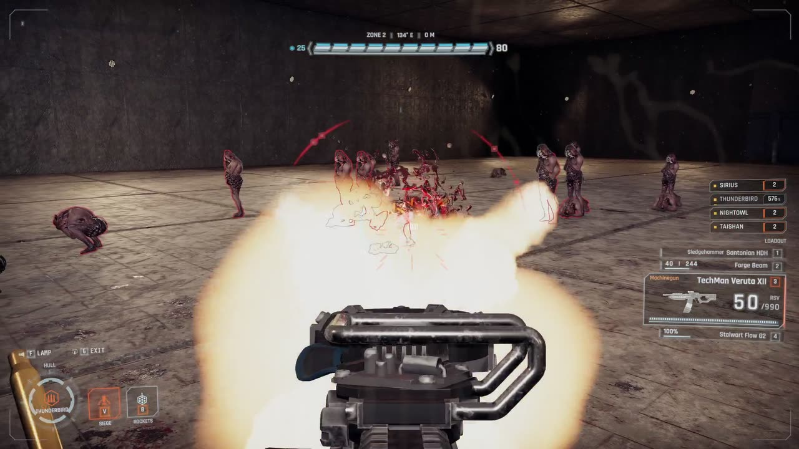 | 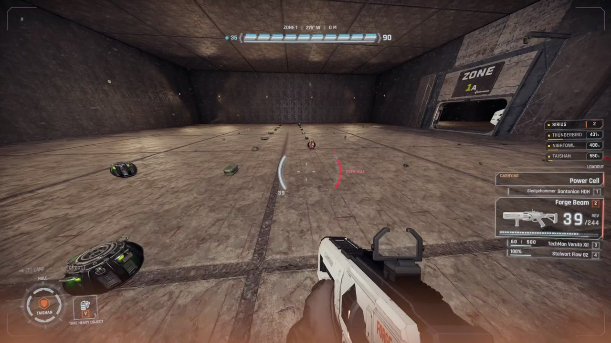 |
| Thunderbird | Taishan carrying a cell |

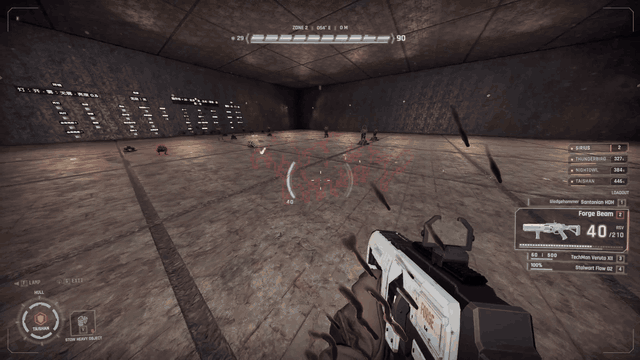

- Walk up behind an empty suit and hold the Use key to climb in. Climbing in plays a short animation, then the screen powers up. Moving or firing skips the power-up.
- Everything you normally do still works: jump, crouch, sprint, use, ping, map, chat, reload, switching weapons, tools, ladders and heavy objects.
- The suit's gun takes your special weapon slot, under the game gun's own name. It hits harder than the same gun in your hands. Press your special weapon key again while holding it to switch between the suit's gun and your own special weapon; each keeps its magazine and reserve. Its ammo is limited and nothing refills it: once it runs dry your own special weapon comes back and the suit's gun cannot be picked again. When you climb out your own special weapon comes back and the suit keeps the rounds left in its gun.
- Climbing in with a heavy weapon from [Forge Ordnance Arsenal](https://thunderstore.io/c/gtfo/p/NAinfini/ForgeOrdnance_Arsenal/) puts it away with its ammunition; the switch is always between the suit's gun and your own special weapon. While you pilot, no heavy weapon can be taken from a pod. When you climb out, the heavy weapon comes back as it was (a checkpoint reload ends the heavy weapon's loan instead).
- The suit steadies every gun you hold: less recoil and reloads in three quarters of the time. Your own guns keep their damage, fire rate and magazine.
- Ammo packs and boxes refill only your own gear: primary, tool and your own special weapon, even while the suit's gun stands in for it. A medical pack heals you as usual; it never repairs the suit.
- Every suit walks, sprints and jumps further than you do on foot. **Shift** sprints until the suit overheats and has to cool down. Nightowl is the fastest, then Sirius, Thunderbird and Taishan. Suits have no stamina.
- Every hit lands on the suit's armor, not on you, and the armor stops part of each hit. Armor never regenerates and nothing repairs it. At zero the suit is wrecked and you are thrown out. If you go down for any other reason, you are forced out.
- Your flashlight key switches on the suit's lamp, which is brighter and wider than a flashlight.
- Hold **G** to climb out. The suit stays where it stood, with its remaining armor and ammo, and anyone can climb in.
- Suits are loud. The landing and every step wake sleeping enemies nearby.
- You can still use Forge Ordnance call-ins while wearing a suit.

Inside a suit the normal HUD makes way for the suit's cockpit: armor, barrier and your health at the top with a damage silhouette, magazine and heat beside the crosshair, objectives at the top left, prompts and subtitles under the crosshair, the gun at the bottom right, skills, lamp, exit and teammates at the bottom left, and chat at the bottom right. Nearby enemies show as a faint bearing ring and an outline; an enemy you hit gets a thin health bar with a small damage number, and a kill a short mark; hits glow at the screen edge they came from. Everything comes back when you climb out. English and Chinese.

## Settings

Keys are in the game's settings, Controls, under Forge Frames exosuit:

| Key | Default | Meaning |
|---|---|---|
| Climb out | G | Hold for 0.8 seconds. |
| Charge / siege mode | V | Sirius charge and Thunderbird siege mode. The Taishan barrier and Nightowl scan are passive. |
| Rocket salvo | B | Thunderbird rockets. |

`BepInEx/config/NAinfini.ForgeOrdnanceFrames.cfg`:

| Setting | Default | Meaning |
|---|---|---|
| `Extra lights` | On | Lights on a suit's destruction flash, its burning wreck and the planted siege lamp. |

## Multiplayer

Every player needs the same Frames version. The host decides every hit, boarding and ability. Other players see the suit instead of you.

## Installation

Install with r2modman or the Thunderstore Mod Manager. It also installs Forge Ordnance, MTFO, ForgeCore, ForgeUI, ForgeAudio and ForgeVisual. MTFO marks the game as modded, which turns off achievements and public matchmaking.

## License

Code: [MIT](https://github.com/NAinfini/GTFO-Forge-Mods/blob/main/ForgeOrdnance_Frames/LICENSE). The suit models, sounds and effects keep their own licenses and credits (the four suits are adapted from Halo fan models on Sketchfab, credited there by author), listed in the `LICENSE.txt` files shipped in the package. Three of the four suit models are CC BY-NC 4.0, so this mod is free and non-commercial. Halo and its armor designs belong to Microsoft / 343 Industries; this fan mod is not affiliated with them.

Modding the suits: see the [developer guide](https://github.com/NAinfini/GTFO-Forge-Mods/blob/main/ForgeOrdnance_Frames/DEVELOPERS.md).
