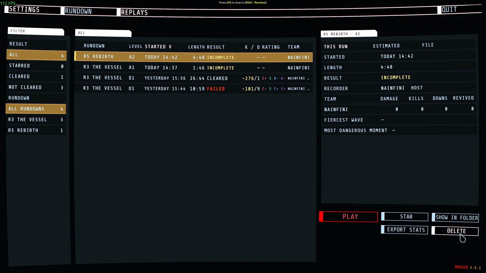

# Forge Replay

Records every level you play and plays it back inside the game, on the normal map, with the normal models, sounds and effects. Open **REPLAYS** in the main menu bar, pick a run and press **PLAY**. Only you need the mod.

Install with r2modman or the Thunderstore Mod Manager; it also installs BepInExPack_GTFO, GTFO_API and ForgeCore. What is recorded, the playback views, the ratings, the settings and the limits are in the [developer guide](https://github.com/NAinfini/GTFO-Forge-Mods/blob/main/ForgeReplay/DEVELOPERS.md).

Report bugs on [GitHub](https://github.com/NAinfini/GTFO-Forge-Mods/issues), or find me on the GTFO Modding Discord as **nainfini**.
