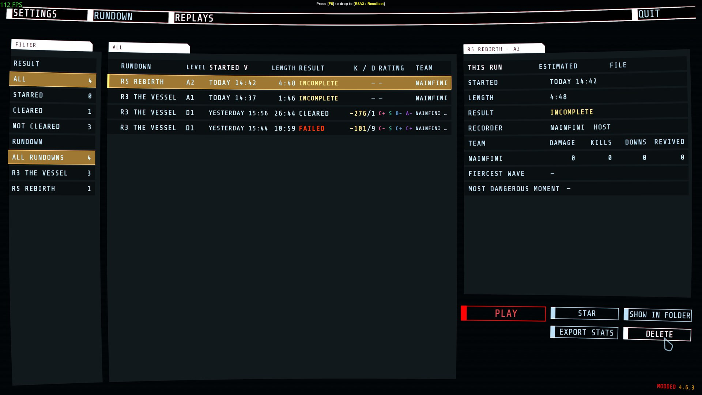
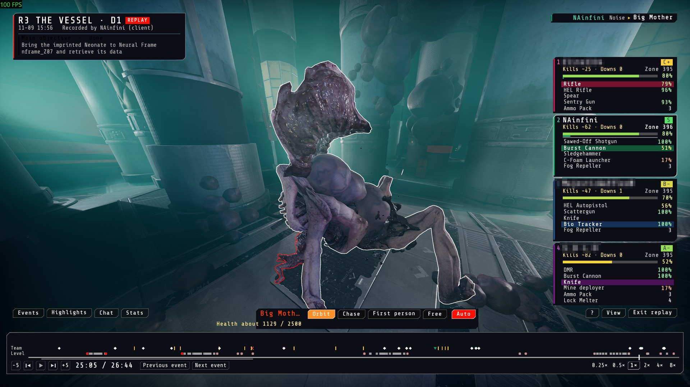
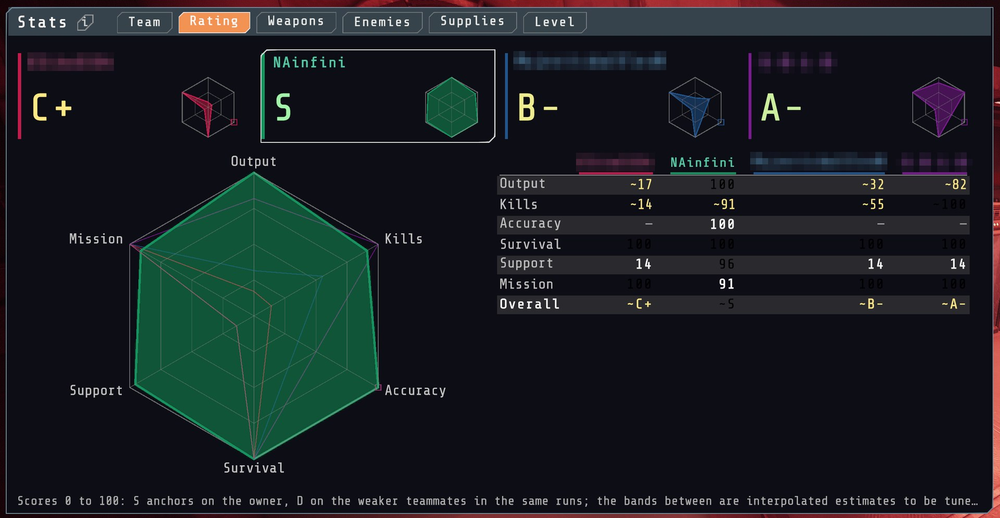
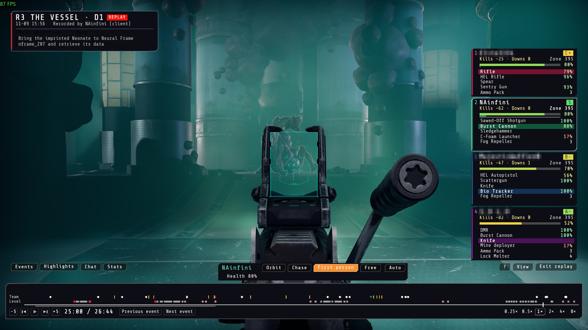

# Forge Replay

Records every level you play and plays it back inside the game, on the normal map, with the normal models, sounds and effects.

Report bugs on [GitHub](https://github.com/NAinfini/GTFO-Forge-Mods/issues), or find me on the GTFO Modding Discord as **nainfini**.

## Recording

Every level is recorded into the `replay` folder beside the game as `.frpl` files, as host or as client. The newest 20 recordings are kept, starred ones are never deleted, and the folder is pruned at 200 MB by default (`Recording.DiskLimitMB`). A recording cut short by a crash or by closing the game still plays up to its last whole second.

Only you need the mod. If the host also runs Forge Replay and is recording, it adds what its game settles for every player (damage, kills, packs, supplies and what hurt each player) to your recording, so your statistics show exact numbers for everyone. Without the host's records, other players' numbers are worked out from the shots and weapon data your game saw and are marked with a `~`.

To stop recording set `Recording.Enabled` to `false` in `BepInEx/config/NAinfini.ForgeReplay.cfg`.

## Watching

Open **REPLAYS** in the main menu bar, pick a run and press **PLAY**. The game starts that level alone from what the recording holds and shows the run again: every player and enemy where it was, the shots, hits, doors, scans, alarms, waves, terminals and chat.

- Time bar: play, pause, drag, step by frame, 0.25x to 8x, with downs, wipes, waves, scans, alarms, the reactor, checkpoints, kills worth a mark, pings and notes marked on it.
- Views: Auto, Chase, First person, Free and Orbit, with an overhead view on its own key. Orbit circles a player with the mouse and the wheel changes the distance. First person shows the recorded player's own eyes, arms and gun, including aiming down sights.
- Watch an enemy: its name and current health show on the plate, with `about` when the health is an estimate. **Esc** goes back to the player.
- Stats: Team, Rating, Weapons, Enemies, Supplies and Level. **Stats → Rating** gives each player a grade from Output, Kills, Accuracy, Survival, Support and Mission, with a radar chart and an overall grade. The replay list and a run's details also show the grades. Grades run from D- to S+, and `~` marks an estimate.
- Player cards, kill feed, chat log, highlights, enemy and teammate outlines, clear fog and brighten, in the game's own colours. Press **Ctrl** to use the mouse, hold **Tab** for the scoreboard.

Give a `.frpl` file to a friend to share a run: they need the same game build and the same level mods.

## Limits

- A recording only plays on the game build and level files it was made on. The list says why a recording cannot be played.
- In a recording made as client, other players' numbers are exact when the host also runs Forge Replay and is recording. Without the host's records, the numbers worked out from shots and weapon data are marked `~`.
- Aiming down sights is only known for the player whose machine recorded the run; another player's first-person view does not show it.
- A run under two minutes, or one where fewer than three of the six rating categories can be worked out, gets no grade.
- Sound is not recorded; the game's own sounds are triggered again by the recorded events, so the voices of other players are not heard.

## Installation

Install with r2modman or the Thunderstore Mod Manager. It also installs BepInExPack_GTFO, GTFO_API, ForgeCore, ForgeUI, ForgeAudio and ForgeVisual.

## For mod authors

The public control, the events other mods can hear and the recording file format are in the [developer guide](https://github.com/NAinfini/GTFO-Forge-Mods/blob/main/ForgeReplay/DEVELOPERS.md).
