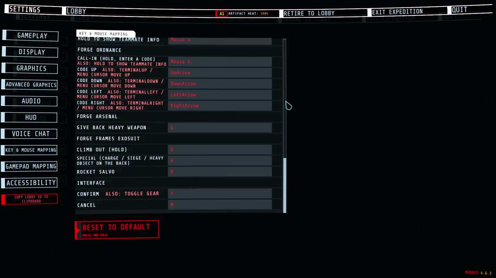
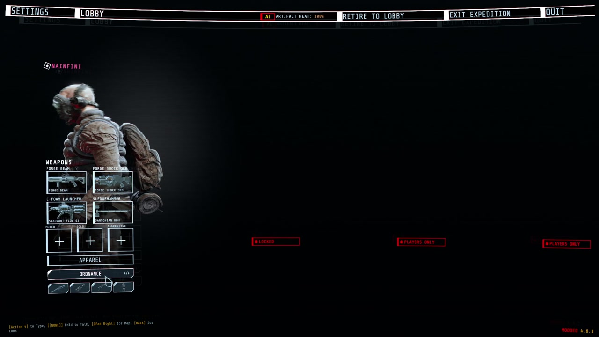
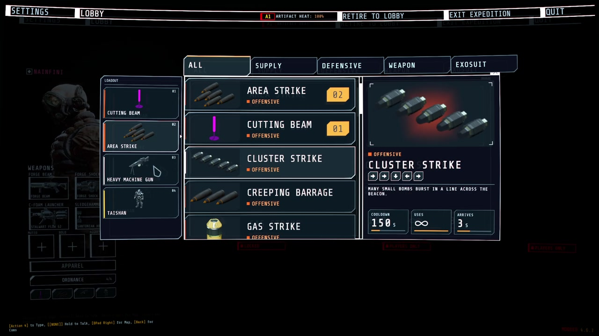

# Forge UI

A shared interface library for GTFO mods. It draws mod buttons, pickers, menu pages and HUD elements in the game's own style, so several mods never cover each other or the game's own HUD.

Forge UI does nothing on its own. With no mod using it, the game looks exactly as it does without it. You normally install it because another mod needs it, such as [Forge Ordnance](https://thunderstore.io/c/gtfo/p/NAinfini/ForgeOrdnance/).

Report bugs on [GitHub](https://github.com/NAinfini/GTFO-Forge-Mods/issues), or find me on the GTFO Modding Discord as **nainfini**.

## What mods can add

- Lobby buttons under APPAREL that open loadout-style pickers.

  

- Buttons and pages on the top menu bar.
- HUD elements in named screen regions. All mods share one layout, one banner queue and one notice list.
- Ready-made HUD pieces: ability slots, key prompts, big centre text, corner notices, world markers, hit markers and damage numbers.
- A full-screen power-on layer, one at a time across all mods.
- Call-in list and inventory drawn in the same style:

  

- Cockpit pieces for vehicles and suits: hiding the game's HUD while piloting (and putting it back), moving the chat, a wide segmented armour bar, arcs beside the crosshair, a ring of contacts out of sight with a turn-around hint, ability slots, a hull damage disc, hit-direction flashes and a faint helmet visor with struts and cracks, plus the game's objectives, prompts, subtitles, inventory and teammates (with infection and ammunition) redrawn in the same style.
- Hit-direction flashes and the visor shade are merged by priority and drawn in one full-screen pass (colour flash, corner shade, low-health pulse, blur, colour split).
- Enemy health bars for the enemies you hit and can see: each hit's lost piece flashes and shrinks, a small damage number rises (a burst adds up into one), and a kill leaves a short mark and a small confirmation by the crosshair.
- A line in the player's own chat box, shown only on their machine, for notices that belong to no screen element.

- Keys you can change: every mod's keys are listed in the game's own settings (Controls), under the game's keys, one heading per mod. Click a key and press the new one; Esc cancels, Backspace or Delete unbinds, the page's reset puts them back. A key two actions or the game also use is marked.
- Texts in several languages: each mod ships one file per language, and every text switches as soon as you change the language.

## Installation

Install with r2modman or the Thunderstore Mod Manager. It also installs BepInExPack_GTFO and ForgeCore. For a manual install, put `ForgeUI.dll` in its own folder under `BepInEx/plugins` and install both of them too.

## Settings

After the first launch, the settings are in `BepInEx/config/NAinfini.ForgeUI.cfg`. Offsets are in pixels at 1080p. Positive values move right or up.

| Setting | Default | Meaning |
|---|---|---|
| `Lobby / ButtonOffsetX`, `ButtonOffsetY` | 0 | Move every lobby button added by mods. Use it when another mod draws over them. |
| `Hud / OffsetX`, `OffsetY` | 0 | Move every HUD element added by mods. |
| `Hud / SafeMargin` | 48 | How far HUD elements keep from the screen edge. Raise it on a TV that crops the picture. |
| `Language / Language` | Auto | Language of the text in every mod that uses the kit. `Auto` follows the game's language; `en`, `zh` or another code forces one. A mod with no file for that language shows English. |
| `Screen / Visor` | On | Draws the helmet visor some mods show. Turn it off for a clear screen. |
| `Screen / VisorFrame` | 0.13 | Opacity of the visor's struts and corner brackets, 0 to 1. |
| `Screen / CracksMax` | 0.3 | Highest opacity of visor cracks. They never cover the middle of the screen. |
| `Screen / HitFlashPeak` | 0.35 | Peak opacity of the hit-direction flash on the screen edge. |
| `Screen / HitFlashSeconds` | 0.3 | How long a full hit flash lasts, 0.1 to 2 seconds. |
| `Screen / Glow` | 1 | Strength of the soft glow round the lit parts of HUD pieces mods draw, 0 to 2. 0 turns it off. |
| `Screen / Fringe` | On | A faint 1 px red and blue colour fringe on those pieces, like a display seen through a visor. |
| `EnemyHealthBars / Enabled` | On | Draws the enemy health bars, damage numbers and kill marks mods switch on. Off hides them in every mod. Written the first time a mod uses them. |

A value that is not a number warns once and uses 0.

Keys you changed are kept in `BepInEx/config/NAinfini.ForgeUI.keys.cfg`; a key you never changed follows the mod's default.

## Reporting a problem

Include the game build, your installed mods, a screenshot and `BepInEx/LogOutput.log`.

## For mod authors

The [developer guide](https://github.com/NAinfini/GTFO-Forge-Mods/blob/main/ForgeUI/DEVELOPERS.md) has the quick start and the API.

## License

Code: [MIT](https://github.com/NAinfini/GTFO-Forge-Mods/blob/main/ForgeUI/LICENSE).

Fonts, under the [SIL Open Font License 1.1](https://openfontlicense.org) (full texts in `fonts/`):

- Rajdhani, © 2014 Indian Type Foundry.
- Glow Sans SC Condensed (未来荧黑), © 2021 Project Welai; the package carries its common-character subset.
