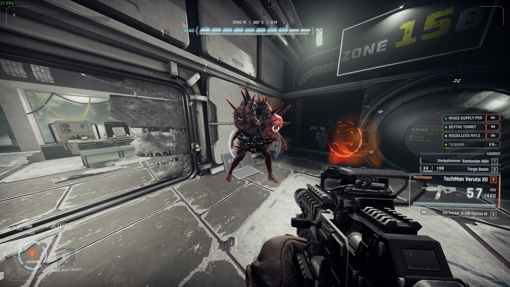
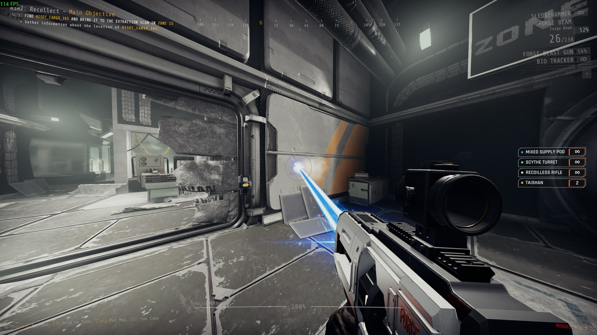
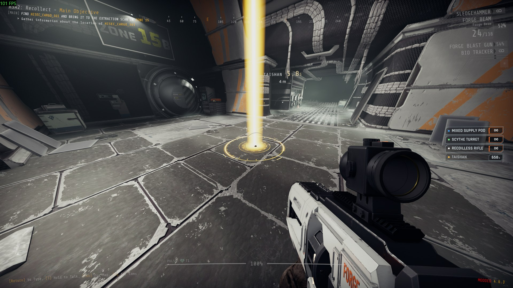
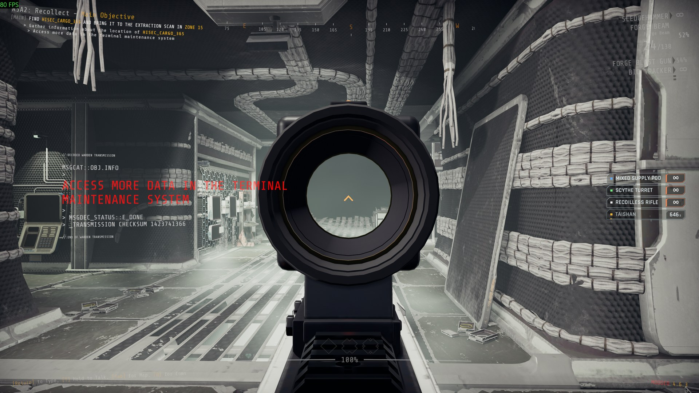

# ForgeVisual

A shared visuals library for GTFO mods: new models, glow, effects, particles, decals, camera shake, outlines round enemies and objects, ground markers, beams and trails.

ForgeVisual does nothing on its own. You normally install it because another mod needs it.

Report bugs on [GitHub](https://github.com/NAinfini/GTFO-Forge-Mods/issues), or find me on the GTFO Modding Discord as **nainfini**.

## What mods can draw

- Outlines round enemies and objects, also through walls (above).
- Beams and trails, lit where they hit:

  

- Markers on the ground, such as where a call-in lands:

  

- New gun models on the game's guns, held by the game's own hands, with red-dot, holographic and 2x sights you aim through:

  

- Explosions and other effects with light that falls on the room, marks left on walls and floors, glow, and camera shake.

## Settings

After the first launch, `BepInEx/config/NAinfini.ForgeVisual.cfg` has:

- **Effects / FlashLights** (default on). Turn it off to stop blasts, hits and muzzles from flashing light on the room around them.
- **Camera / ShakeStrength** (default 1). How strongly blasts, landings and hits shake your view, from 0 (off) to 1, for every mod that uses ForgeVisual.
- **Outlines / Enabled** (default on). Draws the outlines mods put round enemies and objects, including any a mod shows through walls. Off hides them in every mod.

## Installation

Install with r2modman or the Thunderstore Mod Manager. It also installs BepInExPack_GTFO and ForgeCore.

## For mod authors

The public types and an example are in the [developer guide](https://github.com/NAinfini/GTFO-Forge-Mods/blob/main/ForgeVisual/DEVELOPERS.md).

## License

[MIT](https://github.com/NAinfini/GTFO-Forge-Mods/blob/main/ForgeVisual/LICENSE).
