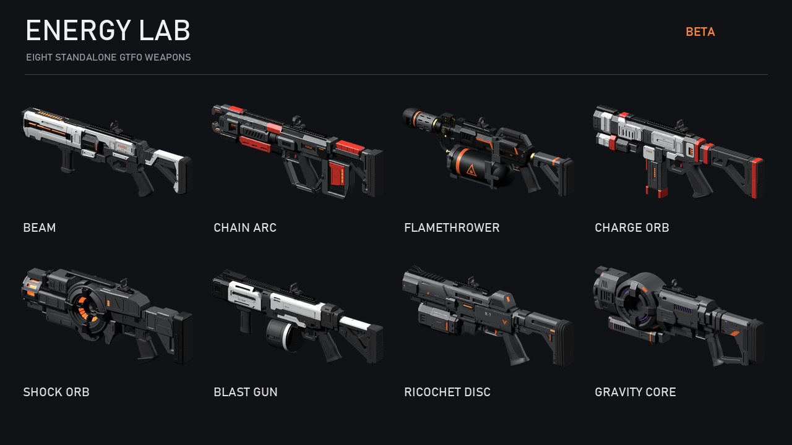
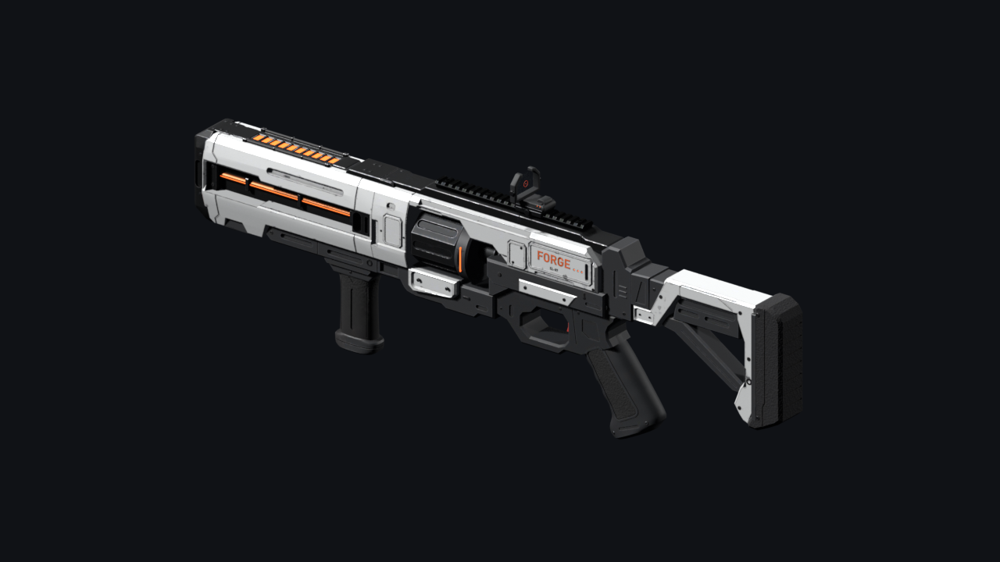
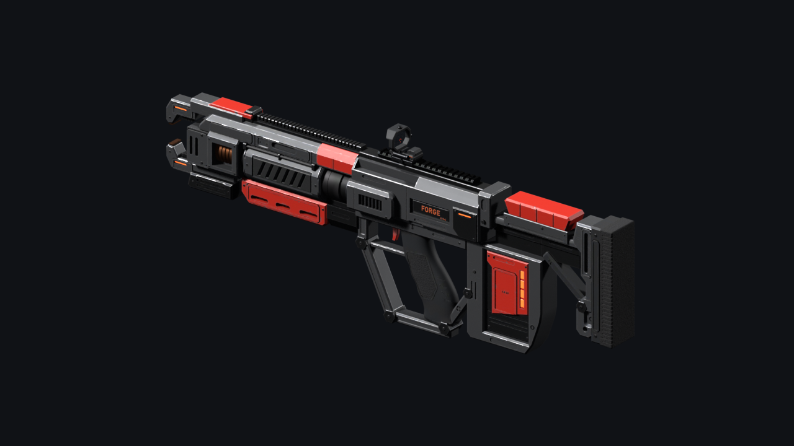
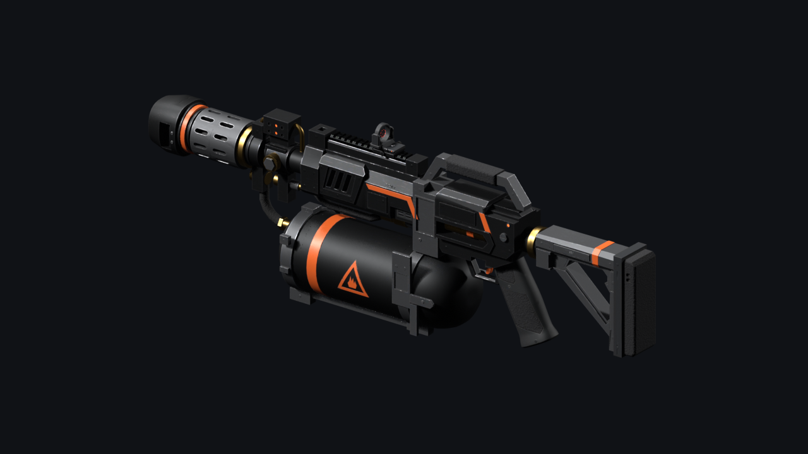
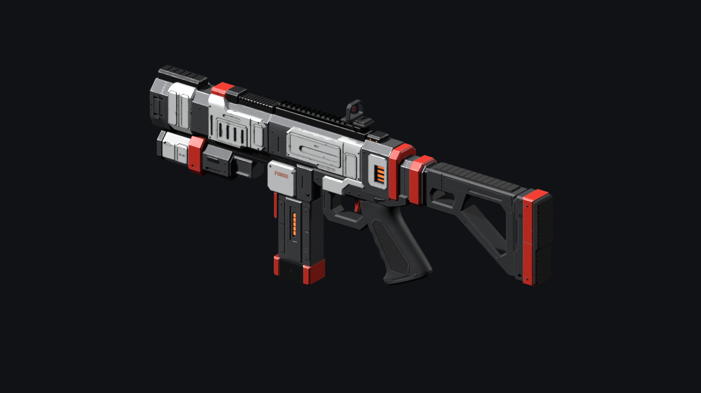
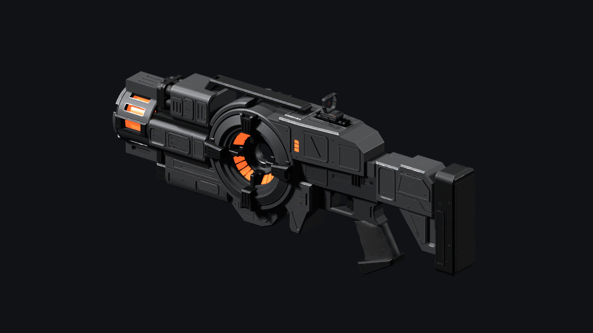
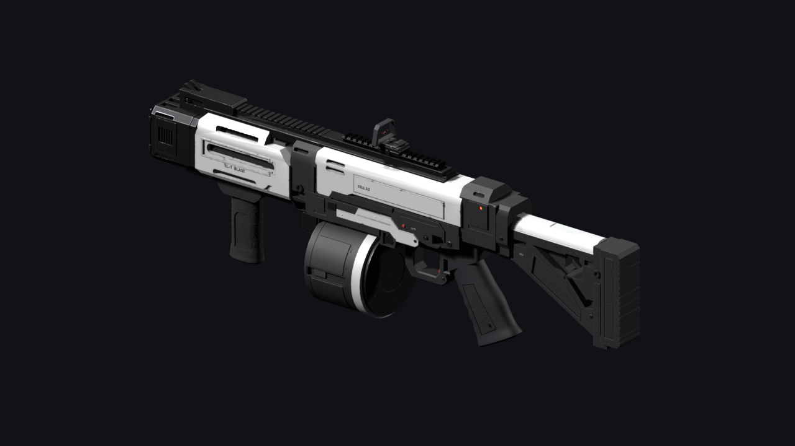
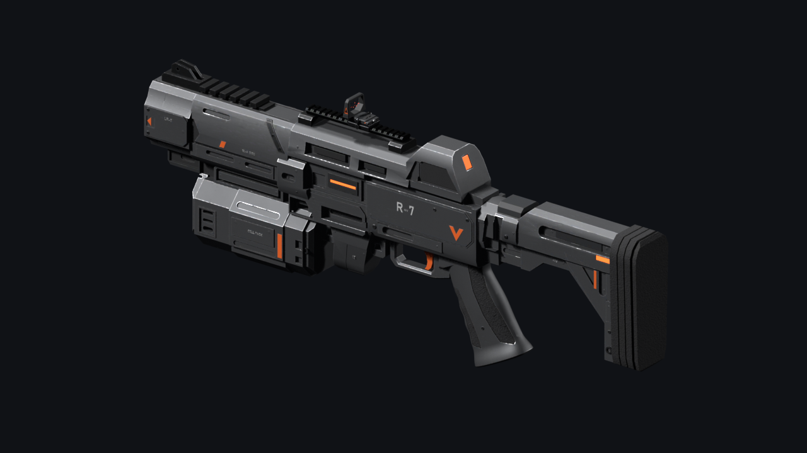
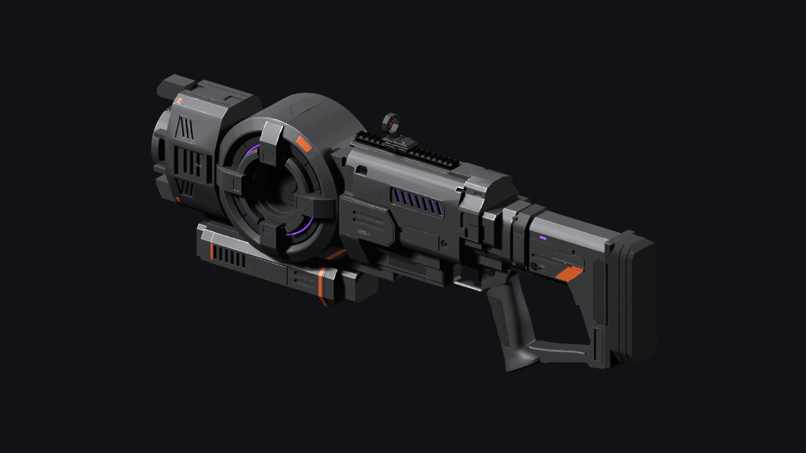

# Forge Weapon Energy Lab

Eight energy guns for GTFO.

Report bugs on [GitHub](https://github.com/NAinfini/GTFO-Forge-Mods/issues), or find me on the GTFO Modding Discord as **nainfini**.



## Weapons

### Forge Beam

Hold fire for a continuous beam. No recoil.



### Forge Chain Arc

Lightning that jumps from the first target to up to three more nearby enemies.



### Forge Flamethrower

A short flame cone that hits everything inside it. No recoil.



### Forge Charge Orb

Hold to charge, release to fire an orb that explodes on impact. More charge, bigger blast.



### Forge Shock Orb

Hold to charge, release to fire an orb that flies through enemies and shocks the ones nearby.



### Forge Blast Gun

A visible shell that flies along your aim and explodes at the first thing it touches, with the heavy grenade launcher's explosion, lifted off the surface so it does not sink in.



### Forge Ricochet Disc

Discs that bounce off walls up to four times.



### Forge Gravity Core

Fires a core that opens a gravity field, pulling enemies in and damaging them.



## Stats

| Weapon | Slot | Magazine | Damage | Range | Area |
| --- | --- | ---: | --- | --- | --- |
| Beam | Main | 40 | 4.35 per tick | Unlimited | - |
| Chain Arc | Main | 7 | 15.9, -20% per hop | 16 m | Hops up to 6 m |
| Flamethrower | Main | 50 | 2.4 per tick | 8 m | Cone |
| Charge Orb | Special | 4 | 12-62.7 | Flies 18-42 m | 1.5-2.5 m blast |
| Shock Orb | Special | 5 | 12-62.7 on contact | Flies 18-42 m | 2-3.5 m shock |
| Blast Gun | Special | 6 | 30.1 | Unlimited | 2.2 m blast |
| Ricochet Disc | Special | 16 | 23.95 | Flies 1.6 s, 4 bounces | - |
| Gravity Core | Special | 2 | up to 9 per pulse | Flies up to 3 s | 5 m field |

## Installation

Install with r2modman; it also installs BepInExPack_GTFO, GTFO_API, MTFO and ForgeCore. Names and descriptions are in English and Chinese and follow the `Language` setting in `NAinfini.ForgeUI.cfg` (by default the game's language). MTFO marks the game as modded, which turns off achievements and public matchmaking, so these guns stay out of official play. Everyone in the lobby needs the same version and the same tuning changes.

## Tuning

Every number is listed in `BepInEx/config/ForgeWeapon_EnergyLab/tuning-defaults.forge`. To change one, copy only that value into `tuning-overrides.forge` in the same folder, for example:

```json
{
  "weapons": {
    "forge.energylab.blast": { "damage": 40, "blastRadius": 3 }
  }
}
```

Restart the game after editing. Values you did not copy follow each update's defaults. If an entry has a mistake, only that gun keeps its normal values and the log names the field. An entry for a gun that is not installed (for example a removed extension) is ignored with one log line.

## Extra guns

Other packages can add more energy guns; they appear in the same loadout list and can be tuned in the same files. Everyone in the lobby must install the same extra packages, otherwise energy weapons stay off between the players who differ.

## License

[MIT](https://github.com/NAinfini/GTFO-Forge-Mods/blob/main/ForgeWeapon_EnergyLab/LICENSE). The effects ship in this package; their sources and licences are listed in `fx-licences.forge`. The sounds were made with Adobe Firefly (commercial use permitted); the Blast Gun's shot and explosion are the Ordnance grenade launcher's sounds, with their credits in `Assets/Audio/LICENSE.txt`.

Modding the guns: see the [developer guide](https://github.com/NAinfini/GTFO-Forge-Mods/blob/main/ForgeWeapon_EnergyLab/DEVELOPERS.md).
