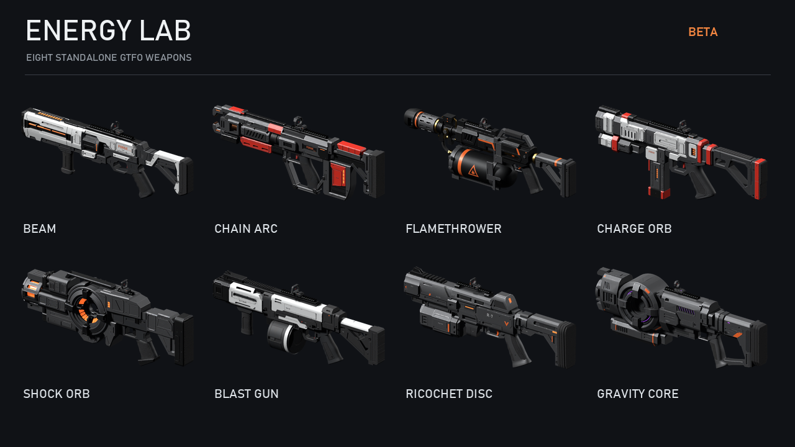

# Forge Weapon Energy Lab

Eight energy guns for GTFO: a beam, chain lightning, a flamethrower, charge and shock orbs, a blast gun, a ricochet disc and a gravity core.

Install with r2modman; it also installs BepInExPack_GTFO, GTFO_API, MTFO and ForgeCore. MTFO marks the game as modded, which turns off achievements and public matchmaking. Everyone in the lobby needs the same version. Weapon descriptions, stats and tuning are in the [developer guide](https://github.com/NAinfini/GTFO-Forge-Mods/blob/main/ForgeWeapon_EnergyLab/DEVELOPERS.md).

Report bugs on [GitHub](https://github.com/NAinfini/GTFO-Forge-Mods/issues), or find me on the GTFO Modding Discord as **nainfini**.

[MIT license](https://github.com/NAinfini/GTFO-Forge-Mods/blob/main/ForgeWeapon_EnergyLab/LICENSE). Effect and sound sources and licences are listed in the files shipped in the package.
